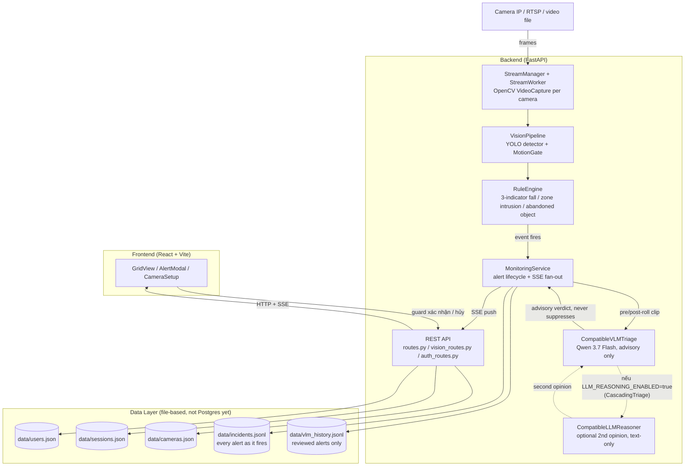
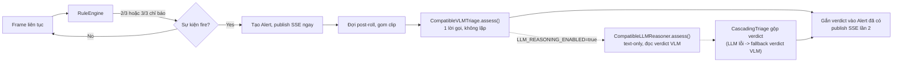
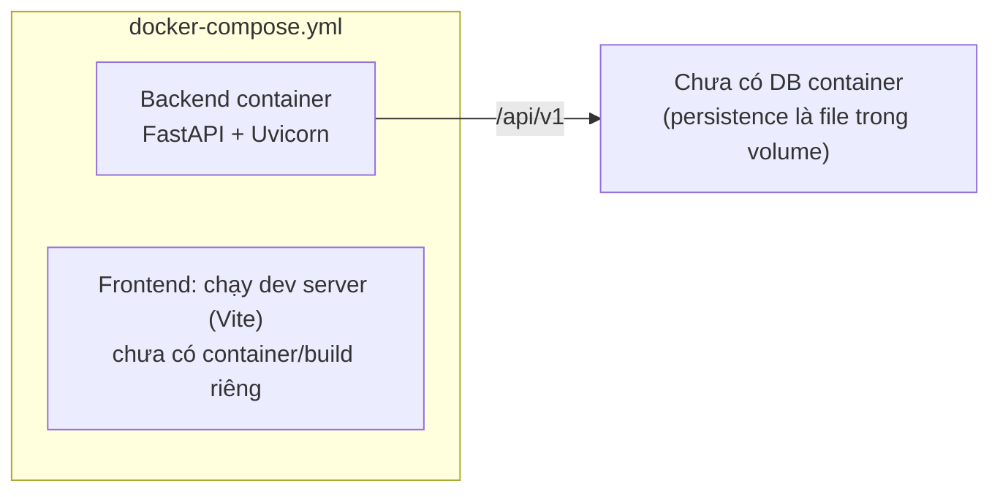

# Architecture Document

## System Overview

Hệ thống AI Agent giám sát an ninh khu đô thị: đọc luồng camera (RTSP hoặc file video) liên
tục, dùng YOLO + rule engine để phát hiện 3 loại sự cố (xâm nhập, té ngã, đồ bỏ quên), sau đó
một VLM (Vision-Language Model) đánh giá ngữ cảnh để gắn nhãn advisory (không tự lọc) lên mỗi
cảnh báo trước khi đẩy real-time qua SSE tới Web Dashboard, nơi bảo vệ xác nhận (HITL) trước
khi báo động được coi là kích hoạt.

## Architecture Diagram

## Components

### 1. Frontend (React + Vite)
- **Purpose:** Dashboard giám sát cho bảo vệ trực chốt — xem grid nhiều camera, nhận popup
  cảnh báo, xác nhận/hủy (HITL), vẽ zone xâm nhập.
- **Key Features:**
  - `GridView.jsx` — lưới nhiều camera, mỗi ô là MJPEG stream từ `/cameras/{id}/stream`
  - `AlertModal.jsx` — popup cảnh báo với nút xác nhận/bỏ qua, hiển thị cả verdict VLM khi có
  - `CameraSetup.jsx` + `PolygonCanvas.jsx` — thêm camera, vẽ polygon zone cho intrusion,
    cấu hình `active_hours`
  - `Login.jsx` — auth bằng cookie session
  - `StatsView.jsx` — thống kê alert theo loại
- **State Management:** không dùng Redux/Zustand — state cục bộ per component + polling/SSE
  qua `api.js`, `incidents.js`.

### 2. Backend (FastAPI)
- **Purpose:** Nhận luồng camera, chạy pipeline phát hiện, quản lý vòng đời alert, phục vụ
  REST + SSE cho dashboard.
- **API Design:** RESTful, prefix `/api/v1`. Các nhóm route chính:
  - `auth_routes.py` — `POST /auth/login`, `GET /auth/me`, `POST /auth/logout`
  - `vision_routes.py` — CRUD camera, `GET /cameras/{id}/stream` (MJPEG), `GET /alerts`,
    `POST /alerts/{id}/acknowledge`, `POST /alerts/{id}/verdict`, `GET /events` (SSE),
    `GET /monitoring/status`
  - `routes.py` — `POST /chat` (LLM chung, chưa phải LangGraph agent thật — xem mục 3)
- **Authentication:** Cookie session tự viết (`src/services/sessions.py`), không dùng JWT.
  `password_work_factor` (scrypt) cấu hình được qua `Settings`. `session_cookie_secure`
  tắt mặc định vì backend chạy plain HTTP ở local — bật khi có TLS thật.

### 3. AI Agent — **hiện KHÔNG phải LangGraph state machine**
Đây là khoảng cách lớn nhất giữa PRD/kiến trúc đã duyệt và code thật:

- **Đã có (`src/services/vlm.py`):** một bước triage đơn (single-call), không phải multi-node
  agent. `CompatibleVLMTriage.assess()` gửi 1 request tới Qwen 3.7 Flash (frames BEFORE/AFTER
  + evidence từ rule engine), nhận về `{verdict, confidence, rationale}`. **Không suppress
  alert bao giờ** — verdict chỉ annotate, giữ đúng nguyên tắc HITL của PRD §3.2.
- **Đã có, tùy chọn (`src/services/llm_reasoner.py`):** `CascadingTriage` (trong `vlm.py`)
  nối thêm một bước thứ hai sau VLM — `CompatibleLLMReasoner` (text-only, không thấy ảnh) đọc
  lại verdict của VLM cùng `rule_evidence` gốc và đưa ý kiến thứ hai, dùng để chống hiện tượng
  VLM "tự tin nhầm" một mình. Vẫn là 2 lời gọi tuần tự, không phải vòng lặp đa bước —
  `CascadingTriage` triển khai cùng protocol `VLMTriage` nên `MonitoringService` không biết có
  bước thứ hai. Tắt mặc định (`LLM_REASONING_ENABLED=false`); nếu tắt hoặc thiếu
  `LLM_API_KEY`, tự hạ cấp về VLM-only chứ không chặn triage. Chi tiết thiết kế và các hạn chế
  đã biết (rationale của VLM chỉ một câu, `rule_evidence` nghèo cho intrusion/abandoned_object):
  `docs/plans/llm-reasoning-node.md`.
- **Đã có (`src/services/llm.py`):** một `ChatOpenAI` client trần trỏ vào Qwen qua
  `llm_base_url`, dùng cho endpoint `/chat` — không có state, không có node, không có tool.
- **Chưa có:** LangGraph Detect → Assess → Plan loop mà PRD §2 và kiến trúc gốc mô tả.
  `langgraph` có trong `requirements.txt` nhưng chưa có node/edge/state schema nào trong code.
- **Vì sao vẫn work được:** logic "phát hiện sự kiện" hiện nằm hoàn toàn ở `RuleEngine`
  (rule-based, không LLM) — LLM/VLM chỉ được gọi ở bước filter false-positive cuối, tối đa 2
  lời gọi tuần tự (VLM rồi LLM), không lặp lại việc suy luận nhiều bước.

### 4. Vision Pipeline & Rule Engine
- **`src/vision/detector.py`** — YOLO (`ultralytics`, weight `yolo26l.pt`) qua
  `IncidentDetector`. Không còn mock: thiếu weight file → `FileNotFoundError` ngay lúc khởi
  tạo, không âm thầm trả `[]`.
- **`src/vision/rule_engine.py`** — logic thuần rule-based, không dùng model riêng cho pose:
  - **Fall detection:** 3 chỉ báo đo trên bounding box — Aspect Ratio (AR), Velocity theo
    trục Y (V_y), Height-drop (dH). Cần ≥2/3 để "arm" nghi vấn, latch tới khi dwell đủ 3s
    hoặc người đứng dậy rõ ràng.
  - **Intrusion:** polygon zone (`ZoneManager`) + `active_hours` (khung giờ cấm) — chỉ báo
    khi có object trong zone đang active theo giờ.
  - **Abandoned object:** vật thể đứng yên quá ngưỡng thời gian, không có "chủ" (person)
    trong bán kính quy định.
- **`src/vision/motion.py`** — `MotionGate`, bộ lọc tiền xử lý để bỏ qua frame tĩnh, giảm tải
  inference (tắt mặc định).
- **Face blur — tạm tắt theo quyết định của mentor (2026-08-10), không phải bug bị bỏ sót.**
  `FaceAnonymizer` (`src/vision/anonymizer.py`, 112 dòng, vẫn còn nguyên trong git history ở
  commit `ee5e896`, lấy lại được bằng `git show ee5e896:src/vision/anonymizer.py`) từng chạy
  blur trên **mọi frame của luồng live** — đúng câu chữ PRD §3.3 nhưng tốn CPU liên tục trên
  nhiều camera × FPS cao. Mentor chỉ đạo: chỉ cần blur **frame đã gắn với một alert thật**
  (thumbnail, clip gửi VLM) chứ không cần blur toàn bộ luồng preview trực tiếp — giảm tải
  đáng kể, đúng tinh thần PRD ("dữ liệu ra ngoài phải được bảo vệ") mà không trả giá hiệu năng
  của bản blur-mọi-frame ban đầu. **Việc còn thiếu:** áp lại `FaceAnonymizer` có chọn lọc —
  chỉ ở bước tạo alert (thumbnail/clip), không ở đường MJPEG preview. Chưa làm gấp theo chỉ
  đạo của mentor, nhưng cần làm trước khi có dữ liệu người thật xuất hiện trong artifact lưu
  trữ dài hạn (`vlm_history.jsonl`, clip gửi VLM ra ngoài qua network).

### 5. Ingestion — Stream Manager / Worker
- **`src/vision/stream_manager.py` + `stream_worker.py`** — mỗi camera một thread riêng,
  đọc qua `cv2.VideoCapture(source, cv2.CAP_FFMPEG)`. `source` nhận cả URL RTSP thật lẫn
  đường dẫn file `.mp4` (dùng để demo bằng dataset công khai như i-LIDS, URFD).
  Video hữu hạn tự loop (`CAP_PROP_POS_FRAMES` reset về 0) để giả lập luồng camera 24/7.
- **`src/vision/stream_simulator.py`** — sinh cấu hình camera giả (RTSP URL pattern) để test
  khả năng scale nhiều luồng song song, không phải nguồn frame thật.

### 6. Database & Persistence — **file-based, chưa phải PostgreSQL**
PRD/kiến trúc gốc (`docs/gate1/brief.md` §5) chỉ định PostgreSQL + Vector DB, nhưng code hiện
tại lưu toàn bộ state bằng file JSON/JSONL dưới `data/` (gitignored):

| File | Nội dung | Service quản lý |
|---|---|---|
| `data/users.json` | Tài khoản bảo vệ/quản lý | `user_store.py` |
| `data/sessions.json` | Session cookie đang hoạt động | `sessions.py` |
| `data/cameras.json` | Cấu hình camera đã thêm | (qua `MonitoringService`) |
| `data/incidents.jsonl` | **Mọi** alert tại thời điểm fire (append-only) | `incident_log.py` |
| `data/vlm_history.jsonl` | Alert **đã được bảo vệ review** kèm verdict | `alert_history.py` |

`requirements.txt` đã comment sẵn `sqlalchemy`/`alembic`/`psycopg2-binary` — hạ tầng migrate
sang Postgres thật đã tính trước nhưng chưa bật.

### 7. Vector Store
- **Chưa triển khai.** PRD §2 mô tả nhánh "Vector DB / History" để Agent tra cứu ngữ cảnh
  sự cố tương tự trong quá khứ. Hiện tại, "lịch sử" mà VLM triage dùng để calibrate
  (`vlm_history_examples`) chỉ là vài dòng gần nhất đọc thẳng từ `data/vlm_history.jsonl`,
  không qua embedding/similarity search.

## Data Flow

1. `StreamWorker` đọc frame liên tục từ camera (RTSP/file) ở `camera_target_fps` cấu hình.
2. `VisionPipeline` chạy `IncidentDetector` (YOLO) → track object → đưa bounding box vào
   `RuleEngine`.
3. `RuleEngine` tích lũy `pos_history` theo thời gian; khi đủ chỉ báo (fall) hoặc điều kiện
   zone/thời gian đứng yên (intrusion/abandoned) được thỏa, nó **fire** một sự kiện.
4. `MonitoringService._on_incident` tạo `Alert`, ghi ngay vào `incidents.jsonl`, publish SSE
   `alert.created` — dashboard nhận cảnh báo tức thời, **không chờ VLM**.
5. Song song, `MonitoringService` đợi hết `vlm_post_roll_sec`, gom clip BEFORE/AFTER, gọi
   `CompatibleVLMTriage.assess()` trong thread pool riêng.
6. Verdict VLM (advisory) được gắn vào đúng `Alert` đó, publish SSE lần 2 để cập nhật UI —
   **verdict không bao giờ tự động ẩn/hủy alert**.
7. Bảo vệ xem popup trên `AlertModal.jsx`, bấm xác nhận hoặc bỏ qua — gọi
   `POST /alerts/{id}/verdict`, ghi kết quả vào `vlm_history.jsonl` để làm dữ liệu review.

## Deployment Architecture

- **Local:** `docker-compose up` cho backend; frontend chạy `npm run dev` (Vite, port 5173)
  riêng, không qua Docker.
- **CI:** `.github/workflows/ci.yml` tồn tại — chạy test suite (163 test hiện tại) trên push.
- **Live URL / Deploy công khai:** **chưa có.** Chưa cấu hình Render/Railway/Vercel — đây là
  một trong 10 deliverable BTC yêu cầu còn thiếu hoàn toàn.

## Security

- API key (Qwen/LLM) lưu trong `.env`, không commit — `.gitignore` đã chặn.
- Input validation qua Pydantic schema (`camera_schemas.py`, `services/schemas.py` TriageRequest...).
- Auth: cookie session tự viết, scrypt hash password, TTL + idle timeout
  (`session_ttl_hours`, `session_idle_minutes`).
- CORS giới hạn theo `cors_origins` (mặc định `localhost:3000,5173`).
- **Rate limiting API:** chưa thấy triển khai — cần bổ sung nếu deploy public.
- **Face blur:** xem chi tiết ở mục Vision Pipeline — tắt trên luồng live theo quyết định
  hiệu năng của mentor, còn thiếu ở bước tạo alert (thumbnail/clip lưu trữ và gửi VLM).

## Design Decisions

| Decision | Choice | Reason |
|----------|--------|--------|
| Framework | FastAPI | Async, auto-docs, type-safe, khớp PRD |
| Agent orchestration | **Single-call VLM triage, chưa LangGraph** | PoC 6 tuần ưu tiên pipeline rule-based chạy được trước; LangGraph state machine để sau khi rule engine ổn định |
| Vision model | YOLO (`ultralytics`) + rule engine tay, không dùng pose model riêng | Bbox-only đủ cho 3 chỉ báo fall, tránh phụ thuộc thêm model MediaPipe đã bị loại khi refactor |
| VLM provider | Qwen 3.7 Flash qua QwenCloud (DashScope-compatible) | Vision-capable, có free quota, tránh cổng Alibaba Cloud yêu cầu xác thực định danh |
| Database | **File JSON/JSONL**, chưa Postgres | Đủ cho PoC single-process; SQLAlchemy đã có sẵn trong requirements (comment out) để migrate khi cần |
| Vector Store | Chưa có | Chưa tới điểm cần similarity search trên lịch sử sự cố |
| Frontend | React + Vite (không phải Next.js) | SPA đơn giản, không cần SSR cho dashboard nội bộ |
