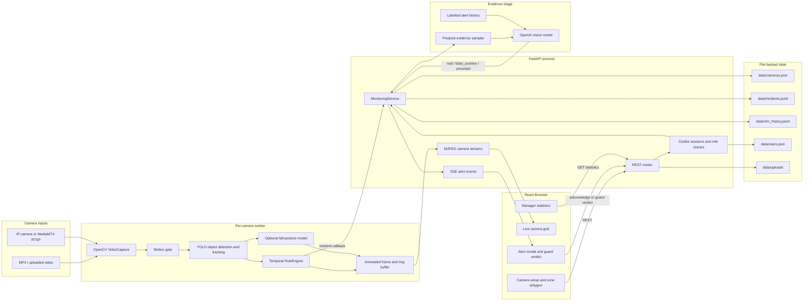

# P-091 Security Monitor Architecture

This repository contains a local, multi-camera incident-monitoring MVP. A guard registers a
video, upload, or RTSP camera, and the backend continuously analyzes frames with YOLO/OpenCV.
Temporal rules turn tracked objects into fall, abandoned-object, and intrusion events. When
enabled, a real OpenAI vision model reviews up to six evidence frames and prior labelled
examples before the guard records the final verdict.

## Component And Data Flow

## Runtime Responsibilities

| Component | Responsibility |
| --- | --- |
| React/Vite frontend | Login, camera setup, polygon drawing, MJPEG grid, SSE alerts, manager view |
| FastAPI | Authentication, camera and alert APIs, MJPEG/SSE transport, statistics |
| `MonitoringService` | Camera registry, worker lifecycle, evidence buffers, triage jobs, and persistence |
| `MultiStreamManager` | Independent pipeline and tracker for every camera |
| `VisionPipeline` | Motion gate, detection, rules, evidence frames, and overlays |
| `IncidentDetector` | YOLO tracking for `person`, `backpack`, `handbag`, and `suitcase` |
| `RuleEngine` | Fall indicators, polygon intrusion, abandoned-object dwell, stitching, and cooldowns |
| `FallPostureDetector` | Optional specialized fall model; it is not used for intrusion |
| `VLMTriage` | Real OpenAI vision review of frames, rule evidence, and labelled history |
| JSON/JSONL files | Local persistence for cameras, users, incidents, and VLM history |
| MediaMTX | Optional RTSP relay used to loop local videos as camera streams |

## Incident Flow

1. A worker reads a frame from a file or RTSP source.
2. YOLO produces tracked objects. `DETECTOR_CONFIDENCE` defaults to `0.40`.
3. The rule engine evaluates history. Intrusion uses the person's foot point in the normalized
   polygon, with a lower-body overlap fallback for partial occlusion.
4. An incident is published to the guard through SSE and written to the local incident log.
5. The asynchronous LangGraph incident workflow waits for post-roll frames, samples before/
   after evidence, and sends the rule reason plus recent labelled examples to the VLM when enabled.
6. The workflow annotates the alert with the VLM result. The guard records the final real/false verdict.
7. The manager endpoint aggregates reviewed history and operational statistics.

## Transport And Authentication

- REST: `/api/v1/*`
- Video: authenticated MJPEG at `/api/v1/cameras/{camera_id}/stream`
- Alerts: authenticated Server-Sent Events at `/api/v1/events`
- Sessions: HttpOnly cookie with guard and manager role enforcement
- Health check: public `GET /health`

## LangGraph Workflows

`src/agents/incident_workflow.py` orchestrates post-alert evidence review asynchronously. It is
not on the camera frame path: YOLO, tracking, and temporal rules remain direct and deterministic.
`POST /api/v1/chat` uses a separate conversational LangGraph graph.

## Deployment

Local development runs Uvicorn and Vite separately. Docker Compose runs FastAPI and an
nginx-served frontend; model weights are mounted read-only and runtime state is mounted at
`./data`.
