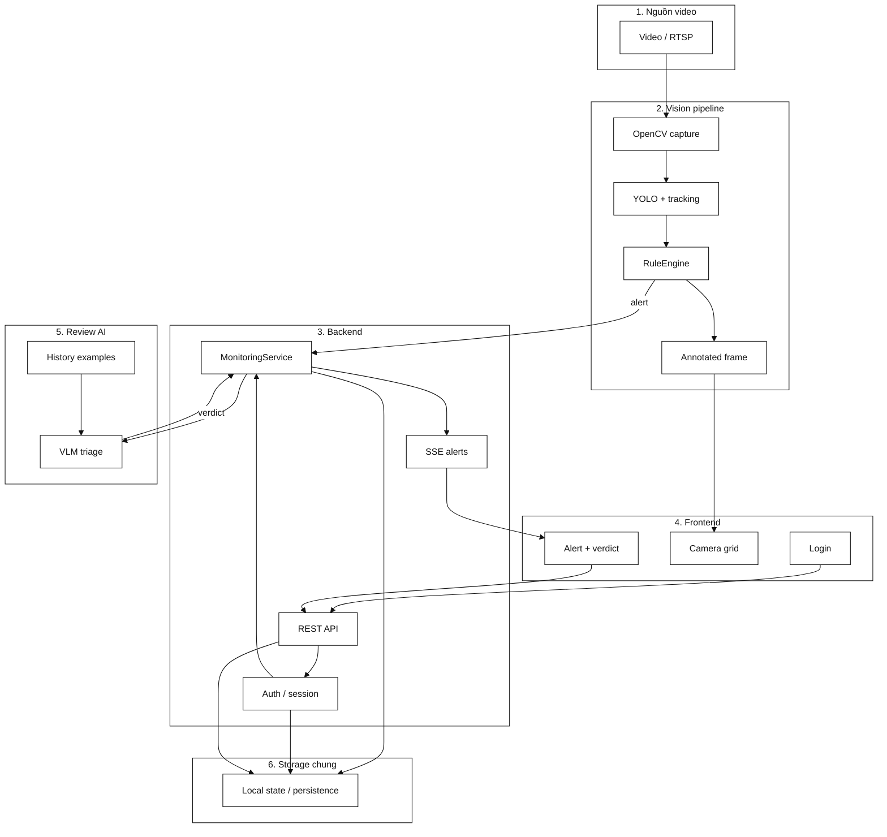

# Kiến trúc P-091 Security Monitor

Kho lưu trữ này là một MVP giám sát sự cố đa camera theo thời gian thực. Bảo vệ đăng ký và thêm
một camera từ video, upload file hoặc RTSP, còn backend liên tục phân tích từng frame bằng YOLO/OpenCV.
Các rule theo thời gian biến các object được track thành sự kiện té ngã, vật thể bỏ quên và xâm nhập.
Khi được bật, mô hình thị giác OpenAI sẽ đánh giá tối đa sáu frame bằng chứng cùng các ví dụ đã gán nhãn
trước khi bảo vệ ghi verdict cuối cùng.

## Thành phần và luồng dữ liệu

## Trách nhiệm runtime

| Thành phần | Trách nhiệm |
| --- | --- |
| React/Vite frontend | Đăng nhập, cấu hình camera, vẽ polygon, lưới MJPEG, SSE alert, manager view |
| FastAPI | Authentication, camera và alert APIs, MJPEG/SSE transport, thống kê |
| `MonitoringService` | Camera registry, lifecycle worker, evidence buffers, triage jobs và persistence |
| `MultiStreamManager` | Pipeline và tracker độc lập cho từng camera |
| `VisionPipeline` | Motion gate, detection, rules, evidence frames và overlay |
| `IncidentDetector` | YOLO tracking cho `person`, `backpack`, `handbag`, `suitcase` |
| `RuleEngine` | Chỉ báo té ngã, xâm nhập bằng polygon, dwell abandoned-object, stitching, cooldown |
| `FallPostureDetector` | Mô hình chuyên biệt cho fall; không dùng cho intrusion |
| `VLMTriage` | Review bằng OpenAI trên các frame, rule evidence và lịch sử đã gán nhãn |
| JSON/JSONL files | Persistence local cho camera, user, incident và VLM history |
| MediaMTX | Relay RTSP tùy chọn để loop video local thành camera |

## Luồng phát hiện sự cố

1. Worker đọc frame từ file hoặc RTSP.
2. YOLO tạo tracked objects. `DETECTOR_CONFIDENCE` mặc định là `0.40`.
3. Rule engine đánh giá lịch sử. Xâm nhập dùng điểm chân của người trong polygon chuẩn hóa,
   với fallback overlap phần thân dưới khi bị che khuất.
4. Một incident được publish tới bảo vệ qua SSE và ghi vào local incident log.
5. Workflow LangGraph bất đồng bộ chờ post-roll frames, thu mẫu evidence trước/sau và gửi rule
   reason cùng ví dụ gán nhãn gần đây tới VLM khi bật.
6. Workflow gắn verdict từ VLM vào alert. Bảo vệ ghi verdict cuối cùng real/false.
7. Manager endpoint tổng hợp lịch sử review và số liệu vận hành.

## Transport và xác thực

- REST: `/api/v1/*`
- Video: MJPEG xác thực tại `/api/v1/cameras/{camera_id}/stream`
- Alerts: Server-Sent Events xác thực tại `/api/v1/events`
- Sessions: HttpOnly cookie với role enforcement cho guard và manager
- Health check: public `GET /health`

## LangGraph workflows

`src/agents/incident_workflow.py` điều phối workflow review sau alert theo kiểu bất đồng bộ. Nó không
nằm trên camera frame path: YOLO, tracking và temporal rules vẫn chạy trực tiếp, xác định và ổn định.
`POST /api/v1/chat` dùng một conversational LangGraph graph riêng.

## Triển khai

Phát triển local chạy Uvicorn và Vite riêng biệt. Docker Compose chạy FastAPI và frontend được phục vụ bởi
nginx; model weights mount read-only và runtime state mount vào `./data`.
