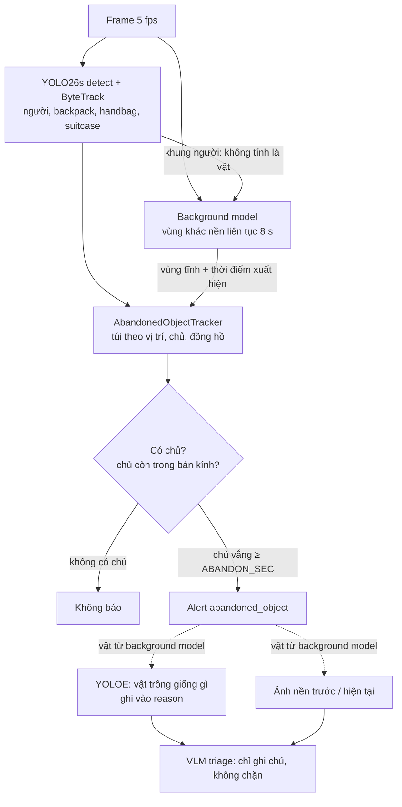

# Kiến trúc phát hiện đồ vật bỏ quên

Tài liệu mô tả pipeline đồ vật bỏ quên đang chạy trên `develop` (merge `bb8e059`, 2026-10-20): từng
tầng làm gì, vì sao có nó, cấu hình ở đâu và đã đo được gì. Số liệu chi tiết từng bước nằm ở
[eval/results/report.md](../eval/results/report.md#benchmark-đồ-vật-bỏ-quên).

## 1. Tổng quan

PRD yêu cầu báo khi một vật (túi, vali, ba lô) nằm yên mà **không còn chủ ở gần** quá
`ABANDON_SEC`. Không có mô hình "bỏ quên / không bỏ quên": YOLO tìm người và túi, một background
model tìm những thứ mới đứng yên mà YOLO không đóng khung, và `AbandonedObjectTracker`
(`src/vision/abandoned.py`) theo dõi từng vật cùng chủ của nó.



| Thành phần | File |
| --- | --- |
| Detector + tracker | `src/vision/detector.py` |
| Background model | `src/vision/static_objects.py` |
| Túi, chủ, đồng hồ, rule | `src/vision/abandoned.py` (gọi từ `src/vision/rule_engine.py`) |
| Nhận lại chủ bằng màu áo (tắt) | `src/vision/appearance.py` |
| YOLOE ghi chú | `src/vision/left_object_check.py`, `scripts/build_left_object_vocab.py` |
| Ghép các bước cho mỗi frame | `src/vision/pipeline.py` |
| Ảnh trước/sau cho VLM | `src/services/monitoring.py` (`_left_object_comparison`), `src/services/vlm.py` |
| Dựng pipeline theo cấu hình, mỗi camera một bản | `src/services/monitoring.py`, `src/vision/stream_manager.py` |
| Benchmark | `src/benchmark/run_abandoned_benchmark.py` |

## 2. Túi theo vị trí, không theo track

Trạng thái (đồng hồ, danh sách chủ) gắn với **một vật ở một chỗ** (`BagState`), không với track ID
của detector. Trên sân ga AVSS một vali lần lượt là `suitcase`, `handbag`, rồi bị người đi qua che
10 s; mỗi lần là một track mới. Khi trạng thái gắn với track, túi quên chủ và nhận người đứng gần
nhất lúc đó — vali của một người đàn ông đứng ngay cạnh bị báo 4 lần.

Một detection được nối vào:

1. túi đã có track đó — chỉ track này mới làm túi "di chuyển" (đang được mang): lệch quá
   `STATIONARY_TOLERANCE_RATIO` (2% bề rộng khung) so với chỗ nằm thì đồng hồ đứng yên bắt đầu lại;
2. nếu không, túi nằm ngay chỗ đó (trong nửa đường chéo của box) — đổi nhãn hoặc đổi ID, không phải
   di chuyển;
3. nếu không, một túi mới.

Túi không thấy quá 30 s (`abandon_memory_sec`) thì bị quên.

## 3. Chủ

- **Chủ là mọi người** trong bán kính `OWNER_RADIUS_RATIO` (25% bề rộng khung) khi túi đang được
  mang hoặc trong `OWNER_BIND_SEC` (3 s) đầu sau khi nằm yên — không chỉ người gần nhất, vì trong
  đám đông người gần nhất thường là người qua đường.
- **Túi có người trông** khi bất kỳ chủ nào ở trong bán kính, nhận theo:
  - track ID;
  - **bàn giao theo vị trí**: track mới chồng lên box cuối của một chủ (IoU ≥ 0.3) trong 2 s sau
    khi chủ đó biến mất là chủ bị tracker đánh số lại (chủ vẫn còn trong khung thì không);
  - stitch của `RuleEngine` khi người đổi ID (`rename_person`);
  - màu áo (`OWNER_APPEARANCE_ENABLED`, **tắt** — xem mục 8).
- **Túi chưa từng có chủ thì không báo** (`ABANDON_REQUIRE_OWNER`): túi đã nằm sẵn khi camera bắt
  đầu quay, hoặc detector chỉ thấy túi sau khi chủ đi. Ở ABODA trường hợp đầu là phần lớn báo nhầm.
- **Túi nằm trong khung một người** (đang cầm, hoặc bị che) không báo ở frame đó, nhưng đồng hồ
  không reset — trong đám đông người đi ngang trước túi liên tục.

Báo khi chủ vắng mặt liên tục `ABANDON_SEC`, đếm từ lúc chủ cuối cùng còn ở gần (hoặc lúc túi nằm
yên). Báo một lần; chủ quay lại thì túi được "trông" trở lại và có thể báo lại sau.

## 4. Background model — vật YOLO không thấy

Sau khi sửa mục 2–3, **cả 11 ca còn sót trên benchmark đều do YOLO không đóng khung vật**: nhỏ, xa,
quay hồng ngoại, hoặc không phải lớp COCO (túi ni lông trên bàn, hộp giấy). Vật vẫn hiện rõ khi so
với cảnh trống. `StaticObjectDetector` (bật bằng `ABANDON_BACKGROUND_ENABLED`, **mặc định bật**):

- Thu nhỏ frame về rộng 384 px (vật CAVIAR chỉ ~11×9 px ở 384×288, nhỏ hơn nữa là mất), làm mờ.
- **Ảnh nền** chỉ được cập nhật (trung bình trượt, hệ số 0.02) ở pixel **khớp** nền. Túi — hay người
  đứng yên — không bao giờ bị học vào nền; người đứng một phút rồi đi không để lại bóng ma.
- Pixel **khác nền** khi chênh > 30 (trên kênh lệch nhiều nhất) và nhớ thời điểm nó bắt đầu khác.
  Khác liên tục **8 s** (`static_sec`) thì là pixel tĩnh. Không có hysteresis: khi nền đã lệch nhẹ,
  hysteresis giữ lại các pixel mà một người đi qua vừa đẩy vượt ngưỡng, tạo ra "vật" là vệt sàn sau
  lưng mỗi người (AVSS, sảnh ABODA ban đêm).
- Khác quá 300 s thì học vào nền (ghế bị dời, cửa để mở không là vật mãi mãi).
- Hơn 40% frame khác cùng lúc là **đổi ánh sáng**, không phải trăm vật: học lại nền từ frame đó.

Từ mặt nạ pixel tĩnh, ba thứ bị bỏ vì không phải vật bị bỏ lại:

| Bỏ | Cách |
| --- | --- |
| Người | Pixel trong khung người (nới 25%, nhớ 2 s vì YOLO chập chờn) không thuộc vùng nào |
| Bóng ma — thứ có trong ảnh nền rồi rời đi (người ở frame đầu, tàu rời ga) | Đường viền vùng phải có ≥ 40% là **cạnh mới** (frame có, nền không có), và nhiều hơn 2 lần số cạnh đã mất. Vật đặt xuống mang theo đường viền của nó; chỗ một thứ đã rời đi thì đường viền nằm trong ảnh nền |
| Đổi sáng, bóng đổ | Cùng phép thử: đổi sáng thay đổi độ sáng, không tạo đường viền mới |

Còn lại các vùng có diện tích 0.04–2% khung (thân tàu lớn hơn nhiều), đủ đặc (≥ 30% box). Mỗi vùng
giữ ID khi còn ở chỗ cũ (IoU ≥ 0.3 với frame trước) và mang `since` — trung vị thời điểm các pixel
tĩnh của nó bắt đầu khác nền, tức lúc vật được đặt xuống.

**Vào rule:** vùng tĩnh là một túi **không bao giờ di chuyển** (nhặt lên đặt chỗ khác là vùng mới),
nhập vào túi YOLO nếu nằm cùng chỗ. Vùng chỉ hiện ra 8 s sau khi vật được đặt, có khi chủ đã đi, nên
rule giữ lịch sử vị trí người 120 s: **chủ là người ở trong bán kính quanh `since`** (± 3 s), đồng hồ
bắt đầu từ `since`, lần cuối được trông là lần cuối một chủ đứng gần sau đó. **Vùng mà không khung
người nào chạm vào quanh `since` thì không có chủ**, nên không bao giờ báo: đó là nền thay đổi (tàu
vào ga, màn hình đổi hình, bóng đổ), không phải ai đặt vật.

Chi phí ~10 ms/frame trên CPU (720p–1080p). Mỗi camera worker có background model riêng (nó giữ ảnh
nền của camera đó).

## 5. YOLOE — vật trông giống gì

Background model báo mọi thứ mới đứng yên, kể cả tàu, cửa mở, người YOLO bỏ sót. Khi nó phát
cảnh báo, `LeftObjectCheck` chạy YOLOE (detector open-vocabulary) một lần trên ảnh cắt quanh vùng
(vùng + chính kích thước của nó mỗi phía), với bộ từ cố định: `bag, backpack, handbag, suitcase,
box, package, luggage` và các "kẻ mạo danh" thường gặp `person, train, door, screen`. Từ có điểm cao
nhất mà box phủ ≥ 30% vùng được ghi vào `reason`:

- ≥ 0.25: `open-vocabulary check: looks like train (0.54), not a left object`
- < 0.25: `open-vocabulary check recognised nothing clearly (weak guess: person 0.06)` — không kết
  luận. Hai túi hồng ngoại ở ABODA bị gọi là "person" với 0.06 và 0.22.
- không có gì: `open-vocabulary check recognised nothing there`

**Không bao giờ chặn cảnh báo.** Trên benchmark, khi YOLOE đủ tự tin nó đúng 10/10 (5 túi, 5 báo
nhầm), nhưng 9 trong 13 ca nó không nhận ra là túi thật — chính những túi nhỏ, xa, hồng ngoại mà
background model được thêm vào để bắt. Ghi chú đến tay người trực và VLM như một bằng chứng.

Chỉ chạy cho cảnh báo của background model (túi YOLO đã đóng khung thì đã được nhận ra), ~150 ms
mỗi cảnh báo trên CPU. Mỗi camera worker có model riêng.

### Dựng trọng số

YOLOE đọc từ khoá qua bộ mã hoá văn bản CLIP (lần đầu ultralytics tự `pip install clip ftfy`, tải
`mobileclip2_b.ts` ~250 MB về thư mục hiện hành). Làm việc đó một lần và lưu trọng số đã "nướng" sẵn
bộ từ, để hệ thống khi chạy chỉ cần ultralytics và một file:

```bash
# Chạy từ một thư mục tạm để file mobileclip không rơi vào repo
python /đường/dẫn/repo/scripts/build_left_object_vocab.py \
    --out /đường/dẫn/repo/src/vision/weights/yoloe-26s-left-objects.pt
```

`--base` mặc định `yoloe-26s-seg.pt` (ultralytics tự tải). File không có trong repo (`*.pt` bị
gitignore). Thiếu file thì pipeline ghi cảnh báo trong log và chạy không có ghi chú. Đổi bộ từ
(`VOCABULARY` trong `left_object_check.py`) thì phải dựng lại.

## 6. Ảnh trước/sau cho VLM

VLM triage nhận một đoạn clip ~5 s trước và 2 s sau lúc cảnh báo. Với đồ bỏ quên, vật được đặt
xuống từ lâu trước đó (8 s của background model, cộng thời gian chủ còn đứng cạnh), nên clip chỉ cho
thấy một cái túi như thể nó luôn ở đó.

Với cảnh báo của background model, `MonitoringService` (ngay trên luồng xử lý của camera, nên đúng
ảnh nền mà cảnh báo dựa vào) ghép **ảnh nền của chỗ đó** (trái, mờ hơn vì ở độ phân giải làm việc)
cạnh **frame lúc cảnh báo** (phải), khoanh đỏ vùng (vẽ lùi ra ngoài vài pixel để không che vật nhỏ).
Ảnh này:

- nối vào cuối clip gửi VLM, kèm một câu trong prompt giải thích nó không thuộc clip;
- vì vậy cũng hiện trong dải ảnh bằng chứng cho người trực;
- giữ trên alert chỉ cho triage (`triage_comparison`, không serialize ra API/SSE).

Cảnh báo bỏ quên cũng không còn khai với VLM là "ảnh đã cắt theo một người": track của chúng là đồ
vật, còn ring chỉ lưu box người, nên clip luôn là toàn cảnh.

## 7. VLM triage

Như các loại cảnh báo khác: bật bằng `VLM_ENABLED`, trả `real` / `false_positive` / `uncertain` và
chỉ **ghi chú** lên alert, không xoá. Hướng dẫn riêng cho `abandoned_object` trong
`src/services/vlm.py`: chỉ `real` khi đồ bị bỏ lại và không còn chủ ở gần. Benchmark không dùng VLM.

## 8. Nhận lại chủ bằng màu áo — có code, tắt mặc định

Histogram HSV phần thân và chân của người quanh túi, lưu 8 mẫu mỗi chủ; người lạ đủ giống
(`OWNER_MATCH_SIMILARITY` 0.85) được coi là chủ quay lại dưới ID mới. Bỏ được báo nhầm cuối cùng
của bước 1a, nhưng 0.8 mất ca AVSS HARD, 0.9 làm báo nhầm quay lại, và ngưỡng được chọn trên chính
dữ liệu đo. "Cùng màu quần áo" không phải "cùng người" — hai người mặc vest tối trông như nhau. Chờ
ReID thật (ví dụ OSNet).

## 9. Cấu hình

| Biến môi trường | Mặc định | Ý nghĩa |
| --- | --- | --- |
| `ABANDON_SEC` | 2.0 | Chủ vắng bao lâu thì báo. **2 s là mặc định demo** để clip ngắn thấy cảnh báo; triển khai kiểu PETS2006/AVSS dùng 30–60 s |
| `OWNER_RADIUS_RATIO` | 0.25 | Bán kính chủ, theo bề rộng khung |
| `STATIONARY_TOLERANCE_RATIO` | 0.02 | Túi lệch hơn ngần này là đang được mang |
| `ABANDON_REQUIRE_OWNER` | true | Túi chưa từng có chủ thì không báo |
| `OWNER_BIND_SEC` | 3.0 | Người gần túi trong bao lâu sau khi nằm yên thì là chủ |
| `OWNER_APPEARANCE_ENABLED` / `OWNER_MATCH_SIMILARITY` | false / 0.85 | Nhận lại chủ bằng màu áo |
| `ABANDON_BACKGROUND_ENABLED` | **true** | Background model |
| `ABANDON_CHECK_WEIGHTS_PATH` | `src/vision/weights/yoloe-26s-left-objects.pt` | YOLOE ghi chú; rỗng hoặc thiếu file thì tắt |
| `DETECTOR_TARGET_LABELS` | `person,backpack,handbag,suitcase,bed,couch` | Lớp túi YOLO đóng khung |
| `ALERT_COOLDOWN_SEC` | 30 | Cooldown theo camera, nhãn và track của vật |

Tham số không có biến môi trường (đổi trong code): `abandon_memory_sec` 30 s, `history_sec` 120 s
(`AbandonedObjectTracker`); `StaticObjectDetector`: `static_sec` 8, `absorb_sec` 300,
`diff_threshold` 30, `person_margin` 0.25, `person_memory_sec` 2, `min_new_edge` 0.4,
`max_area_ratio` 0.02, `work_width` 384; `LeftObjectCheck`: `sure_conf` 0.25.

## 10. Kết quả đo

ABODA + AVSS 2007 + CAVIAR INRIA: 18 lần bỏ quên, 46 phút, chấm theo sự kiện, 5 fps,
`ABANDON_SEC` 2 s, không VLM. Chạy lại:
`python -m src.benchmark.run_abandoned_benchmark --dataset all --label <nhãn>`. Dữ liệu không tự
tải: đặt vào `data/benchmark/` và chuyển sang MP4 theo docstring của file benchmark.

| Chỉ số | ABODA | AVSS 2007 | CAVIAR INRIA | Tổng |
| --- | --- | --- | --- | --- |
| Lần bỏ quên | 11 | 3 | 4 | 18 |
| Recall | 10/11 | 3/3 | 3/4 | 16/18 (89%) [67–97%] |
| Báo nhầm | 2 | 8 | 0 | 10 |
| Báo nhầm / giờ | 5.7 | 51.8 | 0 | 13 |
| Độ trễ sau khi chủ rời đi (trung vị) | 3.2 s | 7.2 s | 2.0 s | |

Đóng góp từng tầng (recall / báo nhầm): baseline 5/18 / 10 → túi theo vị trí + bắt buộc có chủ
7/18 / 1 → + background model 16/18 / 10.

**Nhãn ABODA và mốc "chủ rời đi" của AVSS là nhãn tự gán**, không phải ground truth gốc. Các ngưỡng
của background model và YOLOE được chọn trên chính 18 sự kiện này, nên số liệu lạc quan hơn thực tế.

## 11. Hạn chế đã biết

- **Sân ga có tàu:** 7 trong 10 báo nhầm là tàu vào/rời ga, cửa tàu, mép sân ga ở AVSS. Cách chắc
  nhất là vùng loại trừ theo camera (vùng đường ray) — chưa làm. YOLOE gọi đúng tên 4 trong số đó
  trong `reason`.
- **Người YOLO chỉ thấy một phần** (xếp hàng, đứng sau người khác) có thể thành vùng tĩnh. Mặt nạ
  phân đoạn người không giúp nhiều vì lỗi là YOLO không thấy người, không phải box che sai.
- **Vật sát vật khác** (túi dựa hộp điện, ABODA `video4`) và **vật quá nhỏ** (~11×9 px, CAVIAR
  `LeftBag_AtChair`) vẫn sót.
- **Chủ đổi ID lúc bị che** (ngồi sau người khác, đứng lệch chỗ) vẫn làm báo sớm hoặc báo nhầm; màu
  áo quá mong manh, cần ReID thật.
- **Ai nhặt túi lên không được phân biệt:** người lạ lấy túi cũng làm túi "được trông" và biến mất
  như chủ lấy lại. Cần nhãn "ai lấy" để đo.
- **Dữ liệu ít:** 18 sự kiện, khoảng tin cậy rộng; ngưỡng không có tập kiểm chứng độc lập.
- **Docker** chưa mount `yoloe-26s-left-objects.pt` (cũng như `yolo26s-pose.pt`): bản Docker chạy
  không có ghi chú YOLOE.
