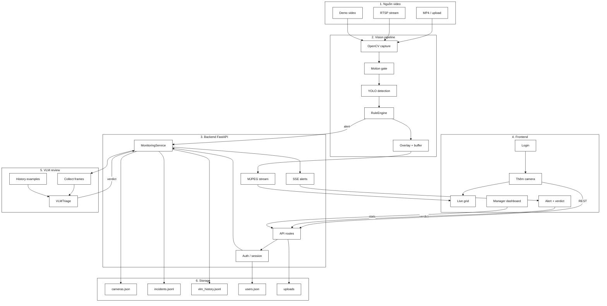

# Kiến trúc hệ thống P-091 Security Monitor

## 1. Tổng quan

P-091 Security Monitor là hệ thống giám sát an ninh đa camera theo thời gian thực, được xây dựng dưới dạng MVP chạy cục bộ hoặc trên Docker. Hệ thống tập trung vào ba nhiệm vụ chính:

- thu nhận video từ file, upload hoặc RTSP;
- phát hiện và theo dõi người/đối tượng bằng YOLO + OpenCV;
- phát hiện sự cố theo thời gian như xâm nhập, té ngã và vật thể bị bỏ quên;
- gửi cảnh báo tới UI cho bảo vệ xem và xác nhận bằng verdict;
- tùy chọn sử dụng VLM để đánh giá chứng cứ hình ảnh sau khi có cảnh báo.

Kiến trúc hệ thống tách rõ ba lớp: giao diện, backend, và pipeline xử lý hình ảnh. Cấu trúc này giúp giữ được độ ổn định của luồng video thời gian thực, đồng thời vẫn cho phép tích hợp đánh giá AI sau khi có cảnh báo.

---

## 2. Mục tiêu hệ thống

- Giám sát nhiều camera đồng thời trong một dashboard tập trung.
- Phát hiện sự cố theo logic thời gian thực và dựa trên lịch sử track.
- Hỗ trợ camera từ MP4, file upload, và RTSP stream.
- Cho phép vẽ vùng giám sát (polygon zone) cho kiểm soát xâm nhập.
- Tạo alert kịp thời qua SSE và MJPEG stream cho người dùng.
- Bổ sung VLM review để hỗ trợ đánh giá lại bằng chứng hình ảnh.
- Lưu trữ lịch sử cảnh báo, hỗ trợ tham chiếu các sự kiện tương tự.

---

## 3. Kiến trúc tổng thể



---

## 4. Các thành phần chính

### 4.1 Frontend

Frontend được xây dựng bằng React + Vite và thực hiện các chức năng sau:

- đăng nhập bảo vệ và quản lý;
- thêm camera mới từ nguồn demo, upload hoặc RTSP;
- vẽ polygon vùng an ninh cho mode xâm nhập;
- hiển thị lưới camera live qua MJPEG;
- hiển thị alert modal và cho phép bảo vệ đánh giá `real` / `false`;
- thống kê manager cho báo cáo và lịch sử review.

### 4.2 Backend FastAPI

Backend đóng vai trò trung tâm của hệ thống, gồm:

- router REST cho auth, camera, alert, statistics;
- session và role-based access control;
- MJPEG endpoint cho stream video;
- SSE endpoint để push cảnh báo tới client;
- lifecycle cho MonitoringService;
- gọi và quản lý VLM triage sau khi cảnh báo được sinh ra.

### 4.3 MonitoringService

`MonitoringService` là lớp điều phối runtime của cả hệ thống. Nó quản lý:

- camera registry;
- worker lifecycle cho từng camera;
- buffer frame cho preview và evidence;
- alert log và lịch sử review;
- trigger VLM review sau khi rule phát hiện sự cố;
- lưu trữ dữ liệu vào file json/jsonl.

Đây là thành phần cốt lõi nối giữa video pipeline và API/UI.

### 4.4 MultiStreamManager và VisionPipeline

- `MultiStreamManager`: quản lý nhiều luồng xử lý đồng thời, một pipeline độc lập cho mỗi camera.
- `VisionPipeline`: gói các bước chính: motion gate, detection, tracking, rule engine, overlay và evidence capture.

Mỗi camera có trạng thái và tracker riêng, tránh chồng chéo dữ liệu giữa các camera.

### 4.5 IncidentDetector

`IncidentDetector` sử dụng YOLO để phát hiện các đối tượng mục tiêu như:

- person
- backpack
- handbag
- suitcase

Đây là lớp nhận diện đầu vào cho rule engine.

### 4.6 RuleEngine

`RuleEngine` là bộ phận quyết định “có phải sự cố hay không”. Hệ thống lưu trạng thái theo track_id và camera_id nên có thể xử lý mượt các tình huống như:

- người đi vào vùng cấm;
- người ngã và nằm yên qua thời gian;
- vật thể bị bỏ quên mà không có người chủ ở gần.

Rule engine giữ được lịch sử theo thời gian, giúp giảm cảnh báo nhầm do chuyển động ngắn hoặc jitter.

### 4.7 VLM triage

Khi `VLM_ENABLED=true`, hệ thống sẽ:

- thu thập ảnh chứng cứ trước và sau sự cố;
- gắn lý do từ rule engine;
- gửi kèm ví dụ lịch sử đã gán nhãn;
- hỏi mô hình thị giác đánh giá verdict như `real`, `false_positive`, hoặc `uncertain`.

Đây là lớp đánh giá bổ trợ, không thay thế logic rule phức tạp trên đường video thời gian thực.

### 4.8 Storage

Project sử dụng local file-backed storage cho MVP:

- `data/cameras.json`: metadata camera
- `data/incidents.jsonl`: log sự cố
- `data/vlm_history.jsonl`: lịch sử triage và verdict
- `data/users.json`: user và role
- `data/uploads`: file video upload

---

## 5. Luồng xử lý sự cố

```text
Nguồn video
  -> OpenCV capture
  -> Motion gate
  -> YOLO detection + tracking
  -> RuleEngine đánh giá lịch sử track
  -> Annotated frame + evidence buffer
  -> Incident xuất hiện
  -> SSE / alert tới frontend
  -> Optional VLM review
  -> Guard verdict
  -> Lưu lịch sử và thống kê
```

Quy trình chính như sau:

1. Video được đọc từ file, upload hoặc RTSP.
2. `MotionGate` giúp bỏ qua các frame không cần xử lý.
3. YOLO phát hiện đối tượng và gắn track_id.
4. `RuleEngine` áp dụng logic temporal để phát hiện xâm nhập, té ngã, hoặc vật thể bị bỏ quên.
5. Khi phát hiện alert, hệ thống push tới frontend qua SSE và lưu vào incident log.
6. Nếu VLM được bật, workflow post-alert thu thập frame chứng cứ và trả verdict hỗ trợ.
7. Bảo vệ xác nhận lại bằng verdict cuối cùng.

---

## 6. Mô hình xác thực và phân quyền

Hệ thống hỗ trợ hai role chính:

- Guard: xem camera, xác nhận cảnh báo, thực hiện verdict.
- Manager: xem thống kê, review lịch sử, quan sát báo cáo tổng hợp.

Xác thực dựa trên session cookie và role checks trên API routes.

---

## 7. Luồng dữ liệu chính

- Người dùng đầu vào: camera, video upload, RTSP stream.
- Pipeline xử lý: frame → detection → tracking → rule engine → alert.
- Giao tiếp frontend: MJPEG để xem video live, SSE để nhận alert.
- Lưu trữ: JSON/JSONL phục vụ data persistence cho MVP.
- Review AI: VLM xem ảnh và đánh giá bằng chứng sau khi alert được tạo.

---

## 8. Mối quan hệ giữa AI và pipeline thời gian thực

Một đặc điểm quan trọng của kiến trúc là:

- Luồng phát hiện thời gian thực (YOLO + RuleEngine) chạy trực tiếp trên frame và ưu tiên latency thấp.
- LangGraph workflow chỉ được dùng cho giai đoạn review sau alert, không chen vào từng frame của camera.

Điều này giúp tránh làm tăng độ trễ hệ thống khi đang phân tích video real-time.

---

## 9. Deployment

### 9.1 Local development

- Backend: Uvicorn chạy `src.main:app`
- Frontend: Vite dev server
- State: đọc/ghi dưới `data/`
- Optional: MediaMTX để loop video local thành RTSP

### 9.2 Docker Compose

Project có cấu hình Docker cho môi trường phát triển và production-like:

- `docker-compose.yml`
- `docker-compose.production.yml`
- `docker-compose.gpu.yml`

Hệ thống mount model weights và dữ liệu runtime vào thư mục `./data` để đảm bảo persistence và dễ triển khai trên máy chủ.

---

## 10. Kết luận

Kiến trúc của P-091 phản ánh đúng một hệ thống giám sát camera chuyên dụng, trong đó:

- pipeline phát hiện và rule engine chạy trực tiếp trên từng camera;
- VLM là layer hỗ trợ đánh giá chứng cứ sau khi alert được sinh ra;
- API và frontend đóng vai trò giao diện vận hành và xác nhận cảnh báo;
- dữ liệu được lưu dưới dạng file-backed state, rất phù hợp cho MVP local deployment.

Đây là mô hình phù hợp cho mục tiêu Demo Day vì cả ba lớp chính đều rõ ràng: phát hiện, review AI, và xác nhận của con người.
