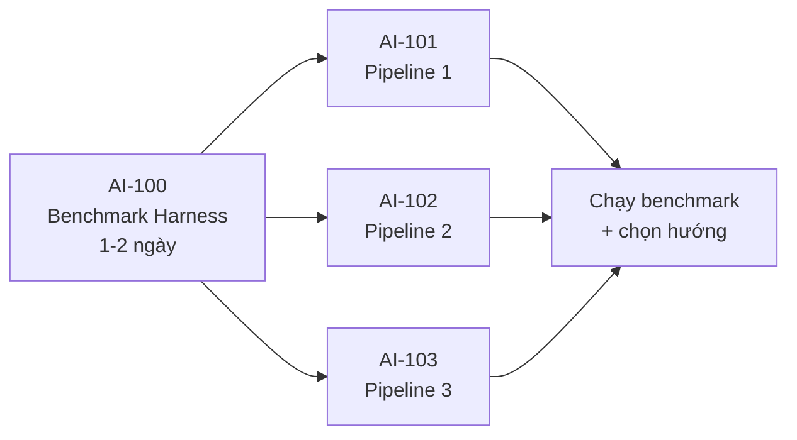

# Benchmark 3 Pipeline Suy Luận — Đặc tả thống nhất

**Mục tiêu:** So sánh 3 hướng triển khai tầng suy luận (Khối 2) để chọn hướng đi chính thức.
**Trạng thái:** Giai đoạn thử nghiệm

---

File này khoá lại 4 thứ, không ai được sửa riêng:

1. Kiểu dữ liệu vào/ra (`PipelineResult`)
2. Bộ test có đáp án (ground truth)
3. Công thức metric
4. Chính sách xử lý lỗi (retry, timeout, fallback)

---

## 1. Đầu vào — `FrameAnalysisResult`

```python
class BoundingBox(BaseModel):
    xmin: int
    ymin: int
    xmax: int
    ymax: int

class IncidentDetection(BaseModel):
    label: str              # person | backpack | handbag | suitcase
                            # | intrusion | fall_detection | abandoned_object
    track_id: str           # "track_42"
    confidence: float       # [0.0, 1.0] — điểm của model Vision
    timestamp: float        # giây, VD 14.5
    camera_id: str          # "cam_01"
    zone_name: str | None
    bbox: BoundingBox

class FrameAnalysisResult(BaseModel):
    frame_id: int
    timestamp: str          # ISO 8601: "2026-08-06T15:00:00Z"
    camera_id: str
    detections: list[IncidentDetection]   # mọi đối tượng thấy được
    events: list[IncidentDetection]       # sự cố RuleEngine đã bắt
```

Pipeline 2 và 3 nhận thêm **ảnh gốc**:

```python
def run(
    frame: FrameAnalysisResult,
    image: bytes | None = None,   # JPEG bytes; None với Pipeline 1
) -> PipelineResult: ...
```

**Lưu ý:** `confidence` trong `IncidentDetection` là điểm của Vision, **không phải** `confidence` trong `PipelineResult`. Hai thứ khác nhau, đừng dùng lẫn.

---

## 2. Đầu ra — `PipelineResult` 

```python
from typing import Literal
from pydantic import BaseModel, Field

Decision = Literal["none", "low", "medium", "high"]

class PipelineResult(BaseModel):
    # --- Phán quyết ---
    decision: Decision
    reasoning: str                        # tiếng Việt, 1-3 câu, nêu căn cứ
    confidence: float = Field(ge=0.0, le=1.0)

    # --- Đo lường ---
    latency_ms: int                       # tổng thời gian, gồm mọi lần gọi + retry
    total_tokens: int                     # tổng prompt + completion, mọi lần gọi
    cost_usd: float                       # tính theo bảng giá ở mục 5

    # --- Truy vết ---
    pipeline_id: Literal["p1_json", "p2_caption", "p3_agent"]
    llm_calls: int                        # số lần gọi model (Pipeline 3 có thể > 1)
    vlm_calls: int                        # số lần gọi có kèm ảnh
    retries: int                          # số lần retry do output hỏng
    error: str | None = None              # None nếu thành công
    raw_trace: dict | None = None         # CoT, caption trung gian… để debug
```

### Định nghĩa `decision`

| Giá trị | Nghĩa | Hành động thực tế |
|---|---|---|
| `none` | Không phải sự cố | Bỏ qua, không ghi nhận |
| `low` | Bất thường nhẹ | Ghi timeline, không báo |
| `medium` | Đáng chú ý | Ghi timeline + thông báo mềm |
| `high` | Nghiêm trọng | Bật popup HITL, bảo vệ phải xác nhận |

Có `none` tách khỏi `low` vì báo động giả cần phân biệt rõ với "có bất thường nhưng nhẹ" — đây chính là thứ benchmark đo.

### Định nghĩa `confidence`

**Pipeline 2 — không lấy trung bình 2 model.** Confidence của VLM (mô tả ảnh chính xác đến đâu) và của Text LLM (phân loại đúng đến đâu) đo hai thứ khác nhau; trung bình chúng ra một số vô nghĩa. Quy tắc:

- `confidence` = confidence của **bước quyết định cuối** (Text LLM Classifier)
- Confidence của VLM ghi riêng vào `raw_trace["vlm_confidence"]` để phân tích sau

---

## 3. Bộ test — ground truth

### Vị trí

```
tests/fixtures/benchmark/
├── cases.jsonl          # 20 ca, mỗi dòng 1 ca
├── images/              # {case_id}.jpg — ảnh 512×384, cho Pipeline 2, 3
└── README.md            # cách thêm ca mới
```

### Cấu trúc một ca

```json
{
  "case_id": "fall_true_003",
  "category": "fall",
  "is_false_alarm": false,
  "expected_decision": "high",
  "acceptable_decisions": ["high"],
  "description": "Người cao tuổi ngã đột ngột ở sảnh, nằm bất động 6 giây",
  "image_file": "fall_true_003.jpg",
  "frame": { "...": "FrameAnalysisResult đầy đủ" }
}
```

| Trường | Ý nghĩa |
|---|---|
| `expected_decision` | Đáp án chuẩn — dùng tính accuracy |
| `acceptable_decisions` | Các đáp án chấp nhận được — dùng tính accuracy nới lỏng. VD ca ranh giới cho phép `["medium", "high"]` |
| `is_false_alarm` | `true` = ca này **không** phải sự cố; dùng tính FP rate |

### Phân bổ 20 ca

| Nhóm | Số ca | Nội dung |
|---|---|---|
| Sự cố thật — rõ ràng | 4 | Ngã bất động, đột nhập ban đêm, vali bỏ lại 10 phút |
| Sự cố thật — khó | 4 | Ngã một phần khuất, đột nhập lúc chạng vạng, túi bỏ nơi đông người |
| Báo động giả — kinh điển | 5 | Tập yoga, ngồi buộc dây giày, tắm nắng, túi cạnh chủ, nhân viên vệ sinh ngoài giờ |
| Báo động giả — khó | 5 | Ngồi bệt dựa tường bất động lâu, túi cách chủ 3m nhưng chủ vẫn nhìn thấy, người mặc đồ tối đi nhanh qua vùng cấm |
| Nhiễu / biên | 2 | Frame trống, ảnh mờ do thiếu sáng |

**Tổng: 20 ca — 8 sự cố thật, 10 báo động giả, 2 biên.**

Vẫn giữ tỉ lệ báo động giả nhiều hơn sự cố thật, vì đó là mục tiêu chính theo PRD. Ca dễ thì cả ba pipeline đều đúng — chính các ca báo động giả khó mới phân biệt được chúng.

**Lưu ý về độ tin cậy:** với 20 ca, mỗi ca chiếm 5% accuracy. Chênh lệch dưới 10% (2 ca) giữa hai pipeline nằm trong nhiễu, không kết luận được. Chỉ tin những khác biệt lớn hơn mức đó — hoặc nhìn vào FP/FN rate, vốn tính trên nhóm nhỏ hơn nên còn nhạy hơn.

### Quy tắc đóng băng

Bộ test **chốt trước khi ai bắt đầu code**. 

---

## 4. Metric

**3 nhóm chỉ số**: khả năng suy luận, tốc độ xử lý, chi phí. Mỗi nhóm có vài con số cụ thể vì một con số duy nhất che mất thông tin quan trọng.

### Nhóm A — Khả năng suy luận

| Metric | Công thức | Vì sao cần |
|---|---|---|
| `accuracy_strict` | Tỉ lệ `decision == expected_decision` | Đo đúng tuyệt đối |
| `accuracy_loose` | Tỉ lệ `decision in acceptable_decisions` | Ca ranh giới không nên bị phạt |
| **`false_positive_rate`** | Trong các ca `is_false_alarm=true`, tỉ lệ trả `medium` hoặc `high` | **Mục tiêu chính của dự án theo PRD** |
| **`false_negative_rate`** | Trong các ca `expected_decision="high"`, tỉ lệ trả `none` hoặc `low` | Bỏ sót người té ngã |

**Tách FP và FN, không gộp vào accuracy.** Hai loại lỗi có hậu quả rất khác nhau: báo động giả làm bảo vệ mệt mỏi và mất niềm tin vào hệ thống; bỏ sót người té ngã có thể chết người. Một pipeline accuracy 85% với FN thấp tốt hơn pipeline accuracy 90% nhưng bỏ sót nhiều.

### Nhóm B — Tốc độ xử lý

| Metric | Công thức | Vì sao cần |
|---|---|---|
| `latency_p50_ms` | Trung vị | Trải nghiệm thường ngày |
| `latency_p95_ms` | Phân vị 95 | Đuôi chậm — Pipeline 3 gọi tool nhiều vòng có đuôi rất dài mà trung bình che mất |

**Không dùng trung bình cộng.** Một ca chậm 15 giây kéo trung bình lên nhưng không phản ánh trải nghiệm điển hình; ngược lại trung bình đẹp có thể giấu việc cứ 20 ca lại có 1 ca chậm 10 giây — bảo vệ sẽ thấy hệ thống "thỉnh thoảng đơ".

**Latency** Ghi nhận latency thực tế của cả 3 pipeline trước, sau khi có số mới đặt ngưỡng hợp lý. Lưu ý để đối chiếu: một lời gọi LLM text-only thường 0.5-2s, gọi có kèm ảnh thường 2-5s 

`latency_ms` trong `PipelineResult` chỉ tính **tầng suy luận** (từ lúc nhận `FrameAnalysisResult` tới lúc trả `PipelineResult`), không gồm Vision inference, queue, ghi DB hay WebSocket.

### Nhóm C — Chi phí

| Metric | Công thức | Vì sao cần |
|---|---|---|
| `cost_per_1k_events_usd` | `mean(cost_usd) × 1000` | Chi phí thật ở quy mô vận hành |
| `total_tokens` | Tổng prompt + completion | Tham khảo, để hiểu cost đến từ đâu |

**Dùng `cost_usd` làm chỉ số chính, không dùng `total_tokens`.** Token ảnh đắt hơn token text khoảng một bậc độ lớn, nên so sánh Pipeline 1 (text-only) với Pipeline 2 (ảnh + text) bằng số token là sai lệch nghiêm trọng — Pipeline 2 có thể ít token hơn nhưng đắt hơn nhiều lần.

Với ~100 camera chạy 24/7, chi phí nhiều khả năng là yếu tố **loại trừ**, không phải accuracy. Một pipeline chính xác hơn 3% nhưng đắt gấp 8 lần thì không dùng được.

### Chỉ số phụ

| Metric | Vì sao ghi nhận |
|---|---|
| `format_error_rate` | Tỉ lệ ca lỗi format sau khi hết retry — pipeline hay lỗi sẽ đội cả latency lẫn cost, cần biết để giải thích số liệu |
| `llm_calls` / `vlm_calls` | Số lời gọi trung bình mỗi ca — giúp hiểu vì sao Pipeline 3 đắt và chậm hơn |

---

## 5. Cấu hình dùng chung & tối ưu chi phí

### Model là biến được giữ cố định

Benchmark này **không so sánh model** — nó so sánh kiến trúc. Ba pipeline dùng **cùng một model**, để chênh lệch kết quả chỉ đến từ cách tổ chức luồng gọi.

Nếu P1 dùng model A còn P3 dùng model B, không có cách nào biết chênh lệch đến từ kiến trúc hay từ model. Đổi model giữa chừng làm mọi số liệu trước đó vô nghĩa.

```python
# src/benchmark/config.py
MODEL = "gpt-5.6-luna"      # OpenAI, nhận cả text và ảnh
API_KEY_ENV = "OPENAI_API_KEY"
```

**Vì sao chọn Luna:** rẻ nhất trong các model OpenAI nhận được ảnh. Model text-only (như DeepSeek) không dùng được vì P2 và P3 cần "mắt" — chỉ chạy được P1.

### Bảng giá

```python
# src/benchmark/pricing.py
PRICING = {
    "gpt-5.6-luna": {
        "input_per_1m": 0.20,
        "output_per_1m": 1.20,
    },
    "gpt-5.6-terra": {          # dự phòng nếu Luna không đủ mạnh
        "input_per_1m": 2.00,
        "output_per_1m": 12.00,
    },
}

def calc_cost(model: str, input_tokens: int, output_tokens: int) -> float:
    p = PRICING[model]
    return (
        input_tokens / 1_000_000 * p["input_per_1m"]
        + output_tokens / 1_000_000 * p["output_per_1m"]
    )
```

**Giá trên lấy từ tìm kiếm web, không phải tài liệu chính thức.** Kiểm tra lại tại trang pricing của OpenAI trước khi chốt ngân sách — giá thay đổi thường xuyên.

**Token ảnh:** API trả về `usage.prompt_tokens` đã bao gồm phần ảnh quy đổi. Dùng trực tiếp con số đó, không tự ước lượng.

---

### Bốn cách tối ưu chi phí

Áp dụng cả bốn, cost benchmark xuống dưới $1 một lần chạy.

#### 1. Mock pipeline khi dựng harness — tiết kiệm nhiều nhất

Giai đoạn viết runner, module metric, xử lý lỗi đều **không cần gọi API thật**. Dùng mock trả về `PipelineResult` cố định:

```python
# src/benchmark/pipelines/mock.py
class MockPipeline(BasePipeline):
    """Trả kết quả cố định, không gọi API. Dùng để test harness."""
    pipeline_id = "mock"

    def run(self, frame, image=None) -> PipelineResult:
        return PipelineResult(
            decision="high", reasoning="mock", confidence=0.9,
            latency_ms=100, total_tokens=500, cost_usd=0.0,
            pipeline_id="mock", llm_calls=1, vlm_calls=0, retries=0,
        )
```

Chỉ gọi API thật ở hai thời điểm: tinh chỉnh prompt (5 ca) và chạy chính thức.

#### 2. Ảnh 512×384 thay vì kích thước gốc

Ảnh lớn tốn nhiều token hơn đáng kể. Với camera giám sát, độ phân giải thấp thường vẫn đủ phân biệt tư thế người và loại vật thể.

Resize toàn bộ ảnh trong `tests/fixtures/benchmark/images/` xuống 512×384 **trước khi** chạy benchmark, không resize lúc runtime (để mọi pipeline nhận cùng một ảnh).

**Kiểm chứng trước:** chạy 3 ca khó nhất với cả hai kích thước. Nếu kết quả khác nhau, độ phân giải đang là biến gây nhiễu — phải dùng ảnh lớn hơn. Chi phí kiểm chứng khoảng $0.02.

#### 3. Prompt caching — đặt phần cố định lên đầu

Phần lặp lại giữa các lời gọi (system prompt, định nghĩa 3 nhãn, bảng severity, danh sách báo động giả) được tính giá thấp hơn nhiều nếu giữ nguyên ở **đầu** prompt.

```python
messages = [
    {"role": "system", "content": SECURITY_RULES},   # CỐ ĐỊNH — được cache
    {"role": "user", "content": case_data},          # THAY ĐỔI mỗi ca
]
```

Với 120 lượt chạy trên cùng một `SECURITY_RULES`, đây là khoản tiết kiệm tự nhiên — chỉ cần không trộn phần thay đổi vào giữa phần cố định.

#### 4. `--repeat 2` thay vì 3

Vẫn phát hiện được dao động (hai lần khác nhau là đủ biết pipeline không ổn định), tiết kiệm 1/3 cost. Đánh đổi: ước lượng độ ổn định kém tin cậy hơn.

---

### Cost dự kiến sau tối ưu

20 ca × 3 pipeline × 2 lần lặp = **120 lượt chạy**.

| Giai đoạn | Cách làm | Cost |
|---|---|---|
| Dựng harness, test runner/metric | Mock pipeline | **$0** |
| Kiểm chứng kích thước ảnh | 3 ca × 2 kích thước | ~$0.02 |
| Tinh chỉnh prompt (3 người) | 5 ca mỗi người, vài lần | ~$0.10-0.30 |
| Chạy chính thức | 120 lượt | **~$0.20-0.40** |

**Tổng cả giai đoạn benchmark: dưới $1.**

Chạy lại 5 lần vẫn dưới $2 — cost không còn là yếu tố cần cân nhắc khi quyết định có chạy lại hay không.

### Cảnh báo: model rẻ có thể làm benchmark mất ý nghĩa

Nếu Luna không đủ mạnh để phân biệt các ca báo động giả khó, cả ba pipeline sẽ cùng sai và bảng kết quả phẳng — không cho biết kiến trúc nào tốt hơn.

**Kiểm chứng bắt buộc trước khi chạy full:** lấy 5 ca khó nhất (nhóm "báo động giả — khó"), chạy P1 và P3.

| Kết quả | Nghĩa là | Làm gì |
|---|---|---|
| P1 và P3 khác nhau rõ | Model đủ nhạy | Dùng Luna cho toàn bộ |
| Cả hai cùng đúng hết | Ca chưa đủ khó | Xem lại bộ test |
| Cả hai cùng sai hết | Model không đủ mạnh | Chuyển sang Terra |

Chi phí kiểm chứng: khoảng $0.05.

---

## 6. Chính sách xử lý lỗi (bắt buộc giống nhau cả 3)

Nếu Pipeline 3 retry 3 lần còn Pipeline 1 không retry, so sánh latency là không công bằng.

```python
MAX_RETRIES = 2           # tối đa 2 lần retry (tổng 3 lần gọi)
TIMEOUT_PER_CALL_S = 30   # timeout mỗi lời gọi model
```

### Khi output không parse được thành JSON

1. Retry tối đa 2 lần, mỗi lần thêm vào prompt: *"Lần trước bạn trả về sai định dạng. Chỉ trả về JSON hợp lệ."*
2. Vẫn hỏng → trả về:
   ```python
   PipelineResult(
       decision="high",        # fail-safe: thà báo thừa còn hơn bỏ sót
       reasoning="Không parse được output sau 2 lần thử",
       confidence=0.0,
       error="format_error_after_retries",
       ...
   )
   ```
3. `latency_ms` và `total_tokens` **cộng dồn cả các lần retry** — đây là chi phí thật.
4. Ca này tính vào `format_error_rate`, vẫn tính vào accuracy (với `decision="high"`).

**Vì sao fail-safe là `high` chứ không phải `none`:** bỏ sót sự cố nguy hiểm hơn báo động giả. Nhưng điều này khiến pipeline hay lỗi format sẽ có FP rate cao — đúng như mong muốn, vì đó là chi phí thật của sự thiếu ổn định.

### Riêng Pipeline 3 — giới hạn vòng lặp

```python
MAX_TOOL_CALLS = 2        # tối đa 2 lần gọi VLM Tool
```

**Khi chạm giới hạn mà Agent vẫn chưa chắc chắn:**

```python
PipelineResult(
    decision="medium",      # đẩy cho bảo vệ tự xem, không tự quyết
    confidence=0.4,
    reasoning="Đã truy vấn 2 lần nhưng chưa đủ căn cứ kết luận. Chi tiết: ...",
    ...
)
```

Chọn `medium` chứ không phải `high`: nếu chạm giới hạn mà trả `high`, Pipeline 3 sẽ có FP rate cao bất thường mỗi khi gặp ca khó. `medium` phản ánh đúng trạng thái "không chắc" và vẫn đưa thông tin tới bảo vệ.

Quy tắc này phải nhất quán — không được để mỗi lần chạy ra kết quả khác nhau.

---

## 7. Interface chung cho runner

```python
# src/benchmark/base.py
from abc import ABC, abstractmethod

class BasePipeline(ABC):
    pipeline_id: str

    @abstractmethod
    def run(
        self,
        frame: FrameAnalysisResult,
        image: bytes | None = None,
    ) -> PipelineResult:
        """Chạy 1 ca. Phải tự bắt mọi exception và trả PipelineResult với error != None."""
```

Ba pipeline kế thừa class này:

```python
class P1JsonPipeline(BasePipeline):
    pipeline_id = "p1_json"

class P2CaptionPipeline(BasePipeline):
    pipeline_id = "p2_caption"

class P3AgentPipeline(BasePipeline):
    pipeline_id = "p3_agent"
```

Runner chạy cả ba trên cùng bộ test, xuất bảng so sánh:

```bash
python -m src.benchmark.run --cases tests/fixtures/benchmark/cases.jsonl --repeat 2
```

`--repeat 2`: chạy mỗi ca 2 lần vì LLM không tất định. Báo cáo trung vị và ghi nhận ca nào cho kết quả khác nhau giữa hai lần.

### Định dạng báo cáo

Cột nhóm theo 3 nhóm metric: suy luận | tốc độ | chi phí.

```
|             |    SUY LUẬN                              |   TỐC ĐỘ      | CHI PHÍ |      |
| pipeline    | acc_strict | acc_loose | FP rate | FN rate | p50 ms | p95 ms | $/1k | err% |
|-------------|-----------|-----------|---------|---------|--------|--------|------|------|
| p1_json     |     0.700 |     0.767 |   0.267 |   0.083 |    890 |   1240 | 0.42 |  0.0 |
| p2_caption  |     0.800 |     0.867 |   0.133 |   0.083 |   2340 |   3100 | 3.18 |  3.3 |
| p3_agent    |     0.833 |     0.900 |   0.133 |   0.000 |   4120 |   9800 | 5.94 |  6.7 |
```

(Số trong bảng là ví dụ minh hoạ định dạng, không phải kết quả thật.)

---

## 8. Thứ tự thực hiện



**AI-100 phải xong trước.** Không có nó, ba người sẽ tạo ra ba kết quả không đặt cạnh nhau được, và tuần sau phải làm lại.

### [AI-100] Benchmark Harness — sub-tasks

| ID | Việc |
|---|---|
| AI-100.1 | Định nghĩa `PipelineResult`, `Decision`, `BasePipeline` trong `src/benchmark/` |
| AI-100.2 | Dựng 20 ca test + ảnh (resize sẵn 512×384), thống nhất `expected_decision` với ít nhất 2 người |
| AI-100.3 | Viết runner: chạy N pipeline × M ca × R lần lặp, xuất JSON kết quả thô |
| AI-100.4 | Viết module tính metric (accuracy, FP/FN rate, percentile latency, cost) |
| AI-100.5 | Viết `pricing.py` + hàm `calc_cost`, chốt model dùng chung |
| AI-100.6 | Viết mock pipeline (trả kết quả cố định) để test harness trước khi có pipeline thật |

---

## 9. Tiêu chí chọn pipeline thắng cuộc

Chốt trước, tránh tranh cãi sau khi có số:

1. **Loại trừ theo suy luận:** `false_negative_rate > 0.15` → loại, dù accuracy cao đến đâu. Bỏ sót sự cố nghiêm trọng là không chấp nhận được.
2. **Loại trừ theo chi phí:** `cost_per_1k_events_usd` vượt ngân sách vận hành → loại.
3. **Trong số còn lại:** ưu tiên `false_positive_rate` thấp nhất — đây là mục tiêu chính theo PRD.
4. **Nếu hoà:** chọn `latency_p95_ms` thấp hơn.
5. **Nếu vẫn hoà:** chọn cái đơn giản hơn để bảo trì (P1 < P2 < P3 về độ phức tạp).

### Hai con số team cần chốt trước khi chạy

| Cần chốt | Vì sao | Gợi ý cách chốt |
|---|---|---|
| **Ngân sách vận hành** (USD/1000 sự kiện) | Tiêu chí loại trừ số 2 cần con số cụ thể | Ước lượng: 100 camera × số sự cố/ngày × 30 ngày → nhân với cost mỗi pipeline, xem con số nào chấp nhận được |
| **Ngưỡng latency** | Mốc 500ms hiện chỉ là tham khảo | Chạy benchmark trước, xem p95 thực tế của cả 3, rồi đặt ngưỡng dựa trên số thật |

Đặt ngưỡng latency sau khi có số thay vì trước, vì nếu chốt 500ms ngay bây giờ thì Pipeline 2 và 3 bị loại trước khi kịp đo — mà chúng có thể chính xác hơn đáng kể.

**Kết quả có thể là lai ghép:** ví dụ dùng P1 làm bộ lọc rẻ và nhanh ở tầng đầu, chỉ ca nào P1 không chắc mới đẩy sang P3. Cách này thường cho FP rate gần P3 với chi phí gần P1. Đừng loại trừ khả năng này khi đọc kết quả.
