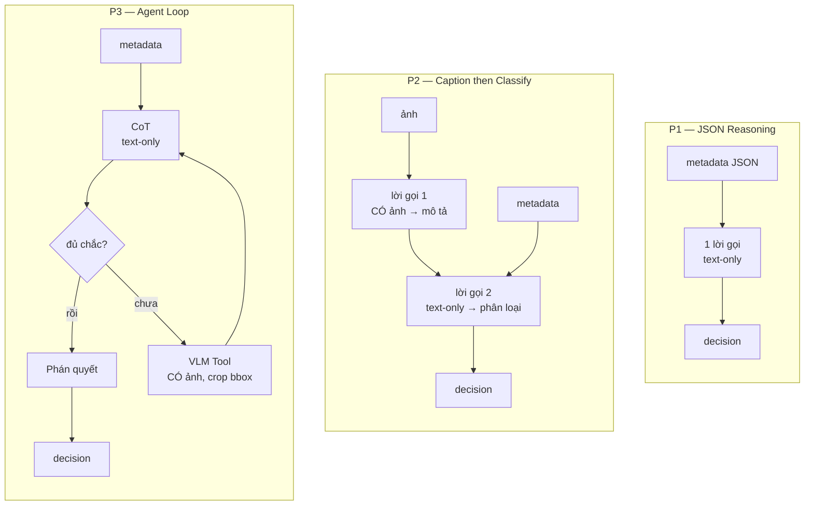
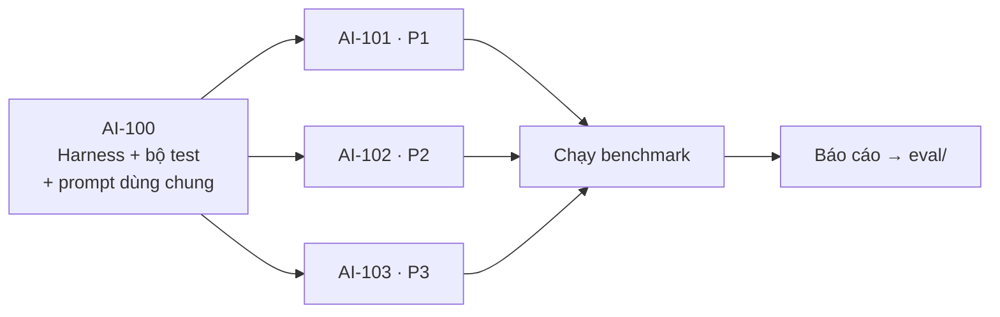

# Đặc tả chi tiết 3 Pipeline

**Mục đích:** Ba người code song song ba pipeline. File này khoá lại thiết kế của từng cái, để người này không phải đoán người kia làm gì.

**Đọc kèm:** `docs/benchmark/pipeline-benchmark.md` (contract vào/ra, bộ test, metric, chính sách lỗi).

---

## Ba pipeline khác nhau ở đâu

Cùng một đầu vào, cùng một đầu ra, khác nhau ở **cách tổ chức lời gọi model**:



Điểm mấu chốt:

| | P1 | P2 | P3 |
|---|---|---|---|
| Số lời gọi model | 1 | 2 | 2-4 |
| Số lời gọi **có ảnh** | 0 | 1 (luôn luôn) | **0-2 (tùy ca)** |
| Rẽ nhánh | Không | Không | Có |
| Cần LangGraph | Không | Không | **Có** |

**P1 và P2 viết bằng hàm Python thuần, không dùng LangGraph.** Bọc chúng vào framework sẽ thêm overhead vào latency của chính chúng, làm ba pipeline trông gần nhau hơn thực tế — che mất đúng thứ benchmark cần đo. LangGraph chỉ đúng chỗ ở P3, nơi có conditional edge và vòng lặp cần giới hạn.

---

## Đầu vào thật — khớp `src/vision/schemas.py` (nhánh `develop`)

Team Vision đã merge module thật. Đặc tả dưới đây bám theo code đó, không phải giả định.

```python
class BoundingBox(BaseModel):
    xmin: int
    ymin: int
    xmax: int
    ymax: int

class IncidentDetection(BaseModel):
    label: str                    # "person" | "backpack" | ... | "intrusion" | "fall_detection" | "abandoned_object"
    track_id: str | None
    confidence: float              # [0.0, 1.0]
    timestamp: float | None        # Unix timestamp giây
    bbox: BoundingBox
    camera_id: str | None
    zone_name: str | None          # chỉ có giá trị thật khi label == "intrusion"
    reason: str | None             # RuleEngine tự sinh, VD:
                                    # "person_105 entered restricted zone 'stairwell' during 22:00-05:00"

class FrameAnalysisResult(BaseModel):
    frame_id: int
    timestamp: str | None
    camera_id: str | None
    detections: list[IncidentDetection]    # mọi vật thể thô thấy được trong frame
    events: list[IncidentDetection]        # chỉ những gì RuleEngine đã bắn thành sự cố
    output_image_path: str | None          # ⚠️ ảnh ĐÃ VẼ overlay/bbox — không dùng cho benchmark
    processing_time_ms: float
```

**Ba khác biệt so với bản nháp ban đầu của tài liệu này:**

| | Bản nháp cũ | Thật (giờ dùng cái này) |
|---|---|---|
| Trường giải thích | Không có | **`reason`** — RuleEngine tự sinh, đưa thẳng vào prompt gần như miễn phí |
| Gộp `detections` | `nearby_objects: list[str]` (tự đặt ra) | Không có sẵn field này — **phải tự viết hàm gộp** ở bước rút gọn |
| Ảnh dùng cho P2/P3 | Không nói rõ nguồn | **Không được lấy từ `output_image_path`** — ảnh đó đã vẽ bbox/nhãn lên, cho VLM nhìn thấy coi như lộ đáp án trước. Bộ ảnh test (AI-100.2) phải là frame gốc chưa annotate |

---

## P1 — Vision to Text LLM (JSON-Based Reasoning)

**Người thực hiện:** Kỹ sư AI / Backend 1
**Ticket:** AI-101
**File:** `src/benchmark/pipelines/p1_json.py`

### Luồng

```
FrameAnalysisResult
  → rút gọn thành JSON cô đọng
  → 1 lời gọi model (text-only) với System Prompt "Chuyên gia An ninh"
  → parse JSON output
  → PipelineResult
```

### Bước 1 — Rút gọn metadata

Không đưa nguyên `FrameAnalysisResult` vào prompt. Nhiều trường không giúp phán quyết mà tốn token.

**Giữ lại:**

```json
{
  "camera": "cam_01",
  "zone": "hanh_lang_tang_3",
  "time": "22:14",
  "events": [
    {
      "label": "fall_detection",
      "track_id": "track_42",
      "confidence": 0.87,
      "bbox": [388, 210, 533, 430],
      "reason": "track_42 collapsed"
    }
  ],
  "nearby_objects": ["person x2", "backpack x1"]
}
```

**Bỏ đi:** `frame_id`, `output_image_path`, `processing_time_ms`, timestamp dạng Unix float (đổi sang giờ đọc được), toạ độ chi tiết của mọi detection không liên quan tới sự cố.

**Giữ `reason`:** RuleEngine đã tự sinh giải thích ngắn gọn cho từng sự cố (xem `src/vision/rule_engine.py`). Đưa thẳng field này vào prompt — cho model thêm ngữ cảnh mà không tốn thêm lời gọi nào.

**`nearby_objects` phải tự viết, không có sẵn trong `FrameAnalysisResult`.** Gộp từ `detections` (danh sách vật thể thô, đầy đủ toạ độ) thành dạng đếm gọn: model cần biết "có 2 người khác gần đó" chứ không cần toạ độ chính xác của từng người.

```python
def summarize_nearby(detections: list[IncidentDetection]) -> list[str]:
    counts = Counter(d.label for d in detections)
    return [f"{label} x{n}" for label, n in counts.items()]
```

### Bước 2 — System Prompt

Cấu trúc bắt buộc (đặt phần cố định lên đầu để tận dụng prompt caching):

```
[CỐ ĐỊNH — không đổi giữa các lời gọi]
1. Vai trò: chuyên gia an ninh khu đô thị
2. Định nghĩa 3 nhãn sự cố + dấu hiệu nhận biết
3. Bảng quy tắc phân loại severity (none/low/medium/high)
4. Danh sách báo động giả kinh điển cần loại trừ
5. Định dạng output JSON bắt buộc

[THAY ĐỔI — mỗi ca một khác]
6. Dữ liệu sự cố JSON
```

Ví dụ mục 4 (quan trọng nhất cho FP rate):

```
Các tình huống KHÔNG phải sự cố, dù metadata có vẻ khớp:
- Người nằm/ngồi bất động nhưng có chuyển động nhịp điệu → tập luyện
- Vật thể tĩnh nhưng có người trong bán kính 2m và hướng mặt về phía nó → chủ vẫn ở gần
- Người trong vùng cấm vào giờ hành chính → có thể là nhân viên
```

### Bước 3 — Output

Ép model trả về JSON:

```json
{
  "decision": "high",
  "reasoning": "Người ngã tại hành lang lúc 22:14, nằm bất động 4.2 giây, không có dấu hiệu chuyển động có chủ đích.",
  "confidence": 0.85
}
```

Ba trường còn lại (`latency_ms`, `total_tokens`, `cost_usd`) do code đo, không phải model tự khai.

### Điểm mạnh / yếu dự kiến

| | |
|---|---|
| Mạnh | Nhanh nhất, rẻ nhất, đơn giản nhất để debug — chỉ có một lời gọi |
| Yếu | Không "nhìn" được. Với ca yoga vs té ngã, metadata gần như giống hệt nhau |

### Sub-tasks

| ID | Việc |
|---|---|
| AI-101.1 | Hàm rút gọn `FrameAnalysisResult` → JSON cô đọng |
| AI-101.2 | Viết System Prompt (5 mục cố định như trên) |
| AI-101.3 | Tích hợp API, đo latency và token |
| AI-101.4 | Parse output, xử lý JSON hỏng theo chính sách retry chung |
| AI-101.5 | Test trên 5 ca mẫu trước khi chạy full benchmark |

---

## P2 — VLM Captioning + Text LLM Classifier

**Người thực hiện:** Kỹ sư AI / Backend 2
**Ticket:** AI-102
**File:** `src/benchmark/pipelines/p2_caption.py`

### Luồng

```
ảnh + metadata
  → lời gọi 1: model CÓ ảnh → mô tả bối cảnh (text thuần)
  → lời gọi 2: model text-only → nhận mô tả + metadata → phân loại
  → PipelineResult
```

### Bước 1 — Captioner

Prompt cho lời gọi có ảnh:

```
Mô tả chi tiết trong 2-3 câu:
- Có bao nhiêu người, họ đang ở tư thế gì
- Vị trí không gian (trong nhà/ngoài trời, gần cửa/giữa sảnh)
- Vật thể họ đang cầm hoặc để lại
- Hành vi có vẻ đang diễn ra

Chỉ mô tả những gì nhìn thấy. KHÔNG phán đoán mức độ nguy hiểm.
```

Câu cuối quan trọng: nếu để VLM tự phán đoán nguy hiểm, bước 2 sẽ chỉ lặp lại kết luận của bước 1 — mất ý nghĩa của kiến trúc hai chặng.

**Output mong đợi:** text thuần, không JSON.

```
Một người đang nằm nghiêng trên sàn hành lang, hai tay duỗi
tự nhiên, không có thảm tập hay dụng cụ nào xung quanh. Cách
đó khoảng 3 mét có một chiếc túi xách đặt cạnh tường.
```

### Bước 2 — Classifier

Prompt cho lời gọi text-only:

```
[CỐ ĐỊNH] Vai trò + định nghĩa 3 nhãn + quy tắc severity
          + danh sách báo động giả (giống P1)

[THAY ĐỔI]
Mô tả hình ảnh: {caption từ bước 1}
Dữ liệu cảm biến: {metadata JSON rút gọn}
```

Model phải dùng **cả hai** nguồn. Nếu chỉ dựa vào caption thì mất thông tin thời gian (`still_duration_seconds`); nếu chỉ dựa vào metadata thì thành P1.

### Về `confidence`

**Không lấy trung bình hai model.** Confidence của captioner (mô tả chính xác đến đâu) và của classifier (phân loại đúng đến đâu) đo hai thứ khác nhau.

```python
confidence = classifier_confidence          # dùng cái này
raw_trace["caption"] = caption_text         # lưu để debug
raw_trace["vlm_confidence"] = vlm_conf      # ghi riêng, không gộp
```

### Điểm mạnh / yếu dự kiến

| | |
|---|---|
| Mạnh | Có "mắt" mà vẫn giữ được bước phân loại tách biệt, dễ debug hơn P3 |
| Yếu | Luôn tốn 1 lời gọi ảnh dù ca dễ. Nếu caption sai, classifier sai theo mà không có cách sửa |

Điểm yếu thứ hai đáng đo riêng: khi phân tích kết quả, xem các ca P2 sai có phải do caption mô tả thiếu không.

### Sub-tasks

| ID | Việc |
|---|---|
| AI-102.1 | Prompt captioner, đảm bảo output là text thuần không phán đoán |
| AI-102.2 | Prompt classifier, nhận caption + metadata |
| AI-102.3 | Nối hai bước, cộng dồn latency và token |
| AI-102.4 | Parse output, `confidence` lấy từ classifier |
| AI-102.5 | Test 5 ca, kiểm tra riêng: caption sai có kéo theo classifier sai không |

---

## P3 — LangGraph Agent Loop

**Người thực hiện:** Kỹ sư AI / Backend 3 (rành LangGraph)
**Ticket:** AI-103
**File:** `src/benchmark/pipelines/p3_agent.py`

### Luồng

```
metadata (KHÔNG ảnh ở bước đầu)
  → Node CoT: metadata cho biết gì? đủ chắc chưa?
      ├─ đủ chắc → Node Phán quyết        (0 lời gọi ảnh)
      └─ chưa chắc → Node VLM Tool         (1 lời gọi ảnh)
                     → quay lại CoT
                     (tối đa 2 lần)
  → Node Phán quyết → PipelineResult
```

### Quyết định thiết kế: Node CoT không nhận ảnh

**Đây là điểm khiến P3 khác P2.** Ảnh gốc được truyền vào graph từ đầu, nhưng **chỉ VLM Tool mới đọc nó**.

Lý do: DoD của AI-103 yêu cầu *"Agent biết cách chỉ gọi VLM Tool khi metadata không đủ tự tin (tiết kiệm cost/latency)"*. Muốn đo được điều này thì bước đầu phải mù.

Hệ quả — P3 có ba mức chi phí:

| Kịch bản | Lời gọi | Chi phí tương đương |
|---|---|---|
| Ca dễ, CoT tự tin ngay | 2 text-only | ~P1 |
| Ca vừa, gọi tool 1 lần | 2 text + 1 ảnh | ~P2 |
| Ca khó, gọi tool 2 lần | 3 text + 2 ảnh | Đắt nhất |

Phân bố ba kịch bản này trên 20 ca chính là kết quả đáng giá nhất của P3.

Câu hỏi trong prompt CoT phải sửa cho khớp — không hỏi *"Quan sát thấy gì?"* (Agent chưa nhìn được) mà hỏi:

```
1. Dữ liệu cảm biến cho biết gì?
2. Có yếu tố nào mâu thuẫn hoặc đáng ngờ không?
3. Metadata đã đủ để phán quyết, hay cần nhìn ảnh?
   Nếu cần nhìn, hãy nêu CÂU HỎI CỤ THỂ muốn hỏi về hình ảnh.
```

### State

```python
class AgentState(TypedDict):
    metadata: dict              # JSON rút gọn, giống P1
    image: bytes                # ảnh gốc — chỉ VLM Tool đọc
    cot_steps: list[str]        # lịch sử suy luận
    tool_calls: list[dict]      # [{question, answer}]
    tool_call_count: int        # đếm để chặn vòng lặp
    final_decision: dict | None
```

### VLM Tool — nhận ảnh crop, không phải ảnh gốc

```python
def vlm_tool(image: bytes, bbox: list[int], question: str) -> str:
    """Crop theo bbox có nới rộng 30% mỗi chiều, rồi hỏi model."""
    cropped = crop_with_padding(image, bbox, padding_ratio=0.3)
    return call_model_with_image(cropped, question)
```

**Vì sao crop có nới rộng:** ảnh gốc tốn nhiều token hơn và Agent thường chỉ cần nhìn quanh đối tượng. Nới 30% giữ được ngữ cảnh gần (có thảm tập không? có ai đứng cạnh không?) mà vẫn rẻ hơn ảnh full.

Ticket gốc ghi *"ảnh gốc (hoặc crop theo bbox)"* — dấu ngoặc đơn này là chỗ mỗi người sẽ làm một kiểu. Chốt: **luôn crop có padding**.

### Conditional Edge

```python
def route(state: AgentState) -> str:
    if state["final_decision"] is not None:
        return "verdict"
    if state["tool_call_count"] >= MAX_TOOL_CALLS:   # = 2
        return "verdict_forced"
    return "vlm_tool"
```

### Khi chạm giới hạn tool mà vẫn chưa chắc

```python
PipelineResult(
    decision="medium",          # KHÔNG phải "high"
    confidence=0.4,
    reasoning="Đã truy vấn 2 lần nhưng chưa đủ căn cứ kết luận. ...",
    raw_trace={"stopped_reason": "max_tool_calls"},
)
```

Chọn `medium` chứ không `high`: nếu chạm giới hạn mà trả `high`, P3 sẽ có FP rate cao bất thường mỗi khi gặp ca khó — làm sai lệch benchmark. `medium` phản ánh đúng trạng thái "không chắc" và vẫn đưa thông tin tới bảo vệ.

### `raw_trace` phải ghi gì

```python
raw_trace = {
    "cot_steps": ["...", "..."],
    "tool_calls": [
        {"question": "Người này nằm tự nhiên hay có tư thế tập luyện?",
         "answer": "Nằm nghiêng, tay duỗi tự nhiên, không có thảm tập."}
    ],
    "stopped_reason": "confident" | "max_tool_calls",
}
```

`stopped_reason` quan trọng: nó cho biết bao nhiêu % ca chạm giới hạn. Nếu tỉ lệ cao, giới hạn 2 lần đang quá chặt và cần xem lại.

### Điểm mạnh / yếu dự kiến

| | |
|---|---|
| Mạnh | Tiết kiệm ở ca dễ, sâu ở ca khó. Trace đầy đủ nên debug được vì sao phán sai |
| Yếu | Phức tạp nhất — state machine, routing, giới hạn vòng lặp đều là chỗ có thể hỏng. Latency p95 sẽ cao |

### Sub-tasks

| ID | Việc |
|---|---|
| AI-103.1 | Định nghĩa `AgentState` + khởi tạo graph |
| AI-103.2 | Node CoT (text-only, 3 câu hỏi như trên) |
| AI-103.3 | VLM Tool với crop padding 30% |
| AI-103.4 | Conditional edge + giới hạn `MAX_TOOL_CALLS = 2` |
| AI-103.5 | Node Phán quyết, xử lý cả trường hợp chạm giới hạn |
| AI-103.6 | Test 5 ca, kiểm tra không kẹt vòng lặp, trace đầy đủ |

---

## Bốn điều cả ba người phải làm giống nhau

Nếu khác nhau ở những chỗ này, benchmark mất công bằng:

**1. Cùng một model.** `gpt-5.6-luna`, chốt trong `src/benchmark/config.py`. Đổi model giữa chừng làm mọi số liệu trước đó vô nghĩa.

**2. Cùng chính sách retry.** `MAX_RETRIES = 2`, timeout 30s mỗi lời gọi, fail-safe trả `high`. Xem mục 6 file `pipeline-benchmark.md`.

**3. Cùng phần cố định trong prompt.** Định nghĩa 3 nhãn, bảng severity, danh sách báo động giả — ba người dùng chung một file:

```python
# src/benchmark/prompts/shared.py
SECURITY_RULES = """..."""       # dùng chung cho cả P1, P2, P3
```

Nếu mỗi người tự viết quy tắc phân loại, benchmark đo chất lượng prompt chứ không đo kiến trúc.

**4. Cùng ảnh đầu vào.** Ảnh trong `tests/fixtures/benchmark/images/` đã resize sẵn 512×384. Không ai resize thêm lúc runtime — P2 và P3 phải nhận đúng cùng một ảnh.

Riêng P3 crop theo bbox trong VLM Tool, nhưng crop từ chính ảnh 512×384 đó, không phải từ ảnh gốc.

### Đặt phần cố định lên đầu prompt

Cả ba pipeline đặt `SECURITY_RULES` ở vị trí đầu tiên, phần thay đổi (metadata, caption, ảnh) xuống sau:

```python
messages = [
    {"role": "system", "content": SECURITY_RULES},   # CỐ ĐỊNH — được cache
    {"role": "user", "content": case_data},          # THAY ĐỔI mỗi ca
]
```

Phần prompt lặp lại được tính giá thấp hơn nhiều khi giữ nguyên ở đầu. Với 120 lượt chạy trên cùng một `SECURITY_RULES`, đây là khoản tiết kiệm đáng kể — nhưng chỉ hoạt động nếu không trộn phần thay đổi vào giữa phần cố định.

---

## Thứ tự làm việc



AI-100 phải xong trước. Trong đó `SECURITY_RULES` là thứ ba người cùng chờ — nên làm sớm nhất.
