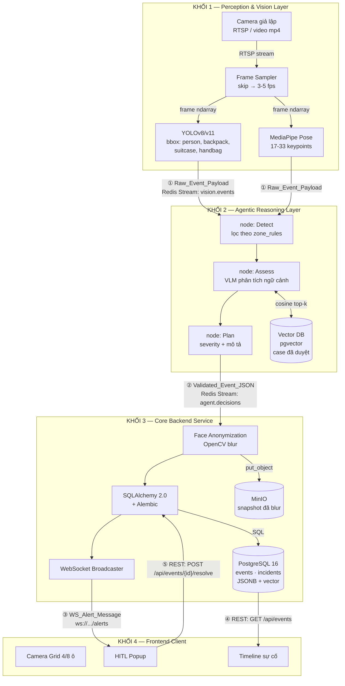
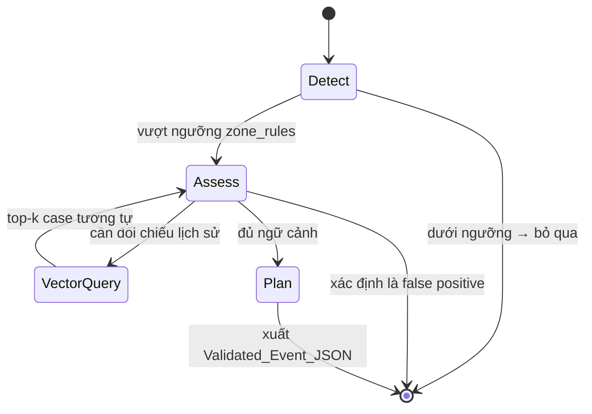
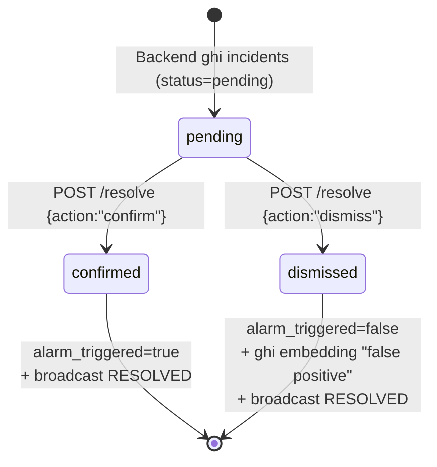

# Kiến trúc Hệ thống & Hợp đồng Dữ liệu

**Dự án:** Hệ Thống AI Agent Giám Sát Ngữ Cảnh & Phản Ứng Sự Cố An Ninh Khu Đô Thị
**Ngày cập nhật:** 04/08/2026

Tài liệu này định nghĩa 4 khối kiến trúc và **hợp đồng dữ liệu (data contract)** giữa chúng. Mỗi khối chỉ cần tôn trọng contract ở ranh giới của mình — không cần biết nội bộ khối khác chạy ra sao.

Nguồn tham chiếu: `docs/gate1/prd.md`, `docs/database/schema.sql`, `docs/database/pipeline.md`.

---

## Quyết định kỹ thuật đã chốt

| Hạng mục | Lựa chọn | Lý do |
|---|---|---|
| ORM | **SQLAlchemy 2.0 + Alembic** | Drizzle ORM chỉ chạy TypeScript/Node, không tương thích FastAPI (Python). SQLAlchemy hỗ trợ JSONB + pgvector tốt, Alembic quản lý migration. |
| Message Queue | **Redis Streams** | Nhẹ, có consumer group + replay khi Agent restart. Đủ cho ~100 camera xoay vòng, không nặng như Kafka. |
| Object Storage | **MinIO** (S3-compatible, self-host) | Đúng ràng buộc PRD "dữ liệu không truyền ra ngoài local server", API S3 nên dễ đổi sang cloud sau. |

---

## Sơ đồ kiến trúc tổng thể



---

## KHỐI 1 — Tầng Thu Nhận & Tiền Xử Lý

**Thành phần:** Sub-process Python độc lập (OpenCV, YOLOv8/v11, MediaPipe)

| | Chi tiết |
|---|---|
| **Input** | Luồng RTSP từ camera giả lập, hoặc file `.mp4` cho PoC |
| **Xử lý** | Frame Skipping xuống 3-5 fps để giảm tải CPU → YOLOv8/v11 trích Bounding Box (xâm nhập, đồ bỏ quên) → MediaPipe Pose trích 17-33 keypoints (té ngã) |
| **Output** | `Raw_Event_Payload` publish lên Redis Stream `vision.events` |
| **Không làm** | Không đánh giá mức độ nguy hiểm, không ghi DB, không làm mờ mặt (việc của Khối 3) |

### ① Contract: `Raw_Event_Payload`

Vision → Redis Stream `vision.events` → Agent

```json
{
  "schema_version": "1.0",
  "payload_id": "550e8400-e29b-41d4-a716-446655440000",
  "camera_id": "cam-a3-hall-01",
  "frame_timestamp": "2026-08-04T22:14:03.482Z",
  "event_type": "fall",
  "track_id": "person_42",
  "confidence": 0.873,
  "snapshot_raw_path": "/tmp/frames/cam-a3_1754344443.jpg",
  "detection_data": {
    "keypoints": [
      {"name": "nose", "x": 412, "y": 233, "visibility": 0.94},
      {"name": "left_shoulder", "x": 388, "y": 291, "visibility": 0.91}
    ],
    "posture_change_rate": 0.82,
    "still_duration_seconds": 4.2
  }
}
```

**`detection_data` thay đổi theo `event_type`:**

| `event_type` | Các khoá bắt buộc trong `detection_data` |
|---|---|
| `intrusion` | `bbox: [x, y, w, h]`, `zone_matched: string`, `consecutive_frames: int` |
| `fall` | `keypoints: [{name, x, y, visibility}]`, `posture_change_rate: float`, `still_duration_seconds: float` |
| `abandoned_object` | `bbox: [x, y, w, h]`, `object_class: string`, `owner_track_id: string \| null`, `owner_last_seen_distance_m: float`, `static_duration_seconds: float` |

**Quy tắc:**
- `snapshot_raw_path` là đường dẫn local **chưa làm mờ mặt** — chỉ Khối 3 được đọc, không bao giờ gửi tới Frontend.
- `confidence` là điểm của model Vision, không phải mức độ nguy hiểm.
- `schema_version` bắt buộc — khi đổi contract phải tăng version để bên nhận biết cách parse.

---

## KHỐI 2 — Tầng Trí Tuệ Tác Vụ

**Thành phần:** LangGraph Workflow, LangChain, VLM, Vector DB (pgvector)

| | Chi tiết |
|---|---|
| **Input** | `Raw_Event_Payload` từ Redis Stream `vision.events` (consumer group `agent-workers`) |
| **Xử lý** | State Machine LangGraph: `Detect` → `Assess` (VLM đọc ảnh, phân tích ngữ cảnh) → `Plan` (đánh giá khẩn cấp, sinh mô tả). Node `Assess` truy vấn Vector DB xem hành vi này đã từng bị đánh dấu "báo động giả" ở góc camera này chưa. |
| **Output** | `Validated_Event_JSON` publish lên Redis Stream `agent.decisions` |
| **Không làm** | Không tự kích hoạt báo động phần cứng, không ghi trực tiếp bảng `incidents` (việc của Khối 3) |

### Luồng nội bộ LangGraph



### ② Contract: `Validated_Event_JSON`

Agent → Redis Stream `agent.decisions` → Backend

```json
{
  "schema_version": "1.0",
  "payload_id": "550e8400-e29b-41d4-a716-446655440000",
  "camera_id": "cam-a3-hall-01",
  "frame_timestamp": "2026-08-04T22:14:03.482Z",
  "event_type": "fall",
  "track_id": "person_42",
  "confidence": 0.873,
  "snapshot_raw_path": "/tmp/frames/cam-a3_1754344443.jpg",
  "detection_data": { "...": "nguyên vẹn từ Raw_Event_Payload" },

  "severity": "high",
  "requires_hitl": true,
  "llm_reasoning": "Người ngã đột ngột tại hành lang tầng 3 lúc 22:14, nằm bất động 4.2 giây. Không phát hiện chuyển động nhịp điệu đặc trưng của tập luyện. Không có case tương tự nào từng được xác nhận là báo động giả tại góc camera này.",
  "context_used": {
    "similar_cases_found": 2,
    "similar_cases_dismissed": 0,
    "zone_rule_applied": "fall_still_duration_seconds=3",
    "time_context": "night"
  },
  "embedding": [0.0123, -0.0456, "... 1536 chiều"]
}
```

**Quy tắc:**
- Agent **giữ nguyên** mọi trường từ `Raw_Event_Payload` và **thêm** các trường đánh giá — không sửa dữ liệu gốc của Vision.
- `severity` ∈ `low` | `medium` | `high`. Chỉ `high` mới đặt `requires_hitl: true`.
- `llm_reasoning` là văn bản hiển thị trực tiếp cho bảo vệ trên popup — viết tiếng Việt, ngắn gọn, nêu rõ căn cứ.
- `embedding` là vector 1536 chiều để ghi vào `incident_context_embeddings`.

---

## KHỐI 3 — Tầng Dịch Vụ Cốt Lõi

**Thành phần:** FastAPI, SQLAlchemy 2.0 + Alembic, PostgreSQL 16 + pgvector, MinIO, WebSockets

| | Chi tiết |
|---|---|
| **Input** | `Validated_Event_JSON` từ Redis Stream `agent.decisions` |
| **Xử lý** | ① Đọc `snapshot_raw_path`, chạy Face Anonymization (OpenCV blur) → upload lên MinIO, nhận `frame_url` → ② Ghi `events` + `incidents` + `incident_context_embeddings` qua SQLAlchemy (JSONB cho `detection_data`) → ③ Broadcast qua WebSocket nếu `requires_hitl` |
| **Output** | `WS_Alert_Message` đẩy tới mọi client đang kết nối; REST API cho Frontend truy vấn |
| **Bắt buộc** | Ảnh gốc chưa blur **không bao giờ** rời khỏi khối này. Chỉ `frame_url` (đã blur, trên MinIO) được gửi ra ngoài. |

### ③ Contract: `WS_Alert_Message`

Backend → WebSocket `ws://<host>/ws/alerts` → Frontend

```json
{
  "schema_version": "1.0",
  "type": "REQUIRE_HITL",
  "incident_id": "9f8e7d6c-5b4a-3210-fedc-ba9876543210",
  "event_id": "1a2b3c4d-5e6f-7890-abcd-ef1234567890",
  "camera_id": "cam-a3-hall-01",
  "camera_name": "Hành lang tầng 3",
  "event_type": "fall",
  "severity": "high",
  "frame_url": "http://minio:9000/snapshots/2026/08/04/9f8e7d6c.jpg",
  "bbox": [388, 210, 145, 220],
  "track_id": "person_42",
  "llm_reasoning": "Người ngã đột ngột tại hành lang tầng 3 lúc 22:14...",
  "occurred_at": "2026-08-04T22:14:03.482Z",
  "created_at": "2026-08-04T22:14:04.117Z"
}
```

**Các loại `type`:**

| `type` | Ý nghĩa | Frontend làm gì |
|---|---|---|
| `REQUIRE_HITL` | Sự cố nghiêm trọng cần bảo vệ xác nhận | Bật popup khẩn cấp đè lên màn hình |
| `INFO_EVENT` | Sự cố mức `low`/`medium`, chỉ ghi nhận | Thêm dòng vào timeline, không bật popup |
| `RESOLVED` | Sự cố đã được người khác xử lý | Tắt popup nếu đang mở cùng `incident_id` |

**Quy tắc:**
- `frame_url` luôn trỏ tới ảnh **đã làm mờ mặt**. Frontend không có đường nào truy cập ảnh gốc.
- `RESOLVED` cần thiết vì nhiều bảo vệ có thể mở dashboard cùng lúc — tránh 2 người xử lý trùng một sự cố.

### REST API

| Method | Endpoint | Mục đích |
|---|---|---|
| `GET` | `/api/events?limit=50&severity=high` | Nạp timeline khi Frontend khởi động |
| `GET` | `/api/events/{id}` | Chi tiết một sự cố |
| `POST` | `/api/events/{id}/resolve` | Bảo vệ xác nhận / bỏ qua (xem ⑤) |
| `GET` | `/api/cameras` | Danh sách camera + `restricted_zone` để vẽ overlay |
| `GET` | `/health` | Healthcheck cho Docker |

### ⑤ Contract: `Resolve_Request` / `Resolve_Response`

Frontend → `POST /api/events/{incident_id}/resolve` → Backend

**Request:**
```json
{
  "action": "dismiss",
  "resolved_by": "3f2a1b0c-9d8e-7f6a-5b4c-3d2e1f0a9b8c",
  "note": "Cư dân tập yoga tại sảnh, không phải té ngã"
}
```

| Trường | Kiểu | Ghi chú |
|---|---|---|
| `action` | `"confirm"` \| `"dismiss"` | `confirm` → kích hoạt báo động phần cứng; `dismiss` → đánh dấu báo động giả |
| `resolved_by` | UUID | FK tới `users.id` |
| `note` | string \| null | Ghi chú tuỳ chọn, dùng làm dữ liệu học cho Vector DB |

**Response `200 OK`:**
```json
{
  "incident_id": "9f8e7d6c-5b4a-3210-fedc-ba9876543210",
  "status": "dismissed",
  "confirmed_by": "3f2a1b0c-9d8e-7f6a-5b4c-3d2e1f0a9b8c",
  "confirmed_at": "2026-08-04T22:14:31.902Z",
  "alarm_triggered": false
}
```

**Response lỗi:**

| Mã | Khi nào | Body |
|---|---|---|
| `404` | `incident_id` không tồn tại | `{"detail": "Incident not found"}` |
| `409` | Sự cố đã được người khác xử lý | `{"detail": "Already resolved", "resolved_by": "...", "status": "confirmed"}` |
| `422` | `action` không hợp lệ | `{"detail": [{"loc": ["body","action"], "msg": "..."}]}` |

**Side effect khi `action = "dismiss"`:** Backend ghi `embedding` của sự cố này vào `incident_context_embeddings` với metadata `{"dismissed_by_human": true}` — lần sau Agent truy vấn Vector DB sẽ thấy case tương tự từng bị bác, giúp giảm báo động giả.

---

## KHỐI 4 — Tầng Giao Diện Người Dùng

**Thành phần:** ReactJS Dashboard

| | Chi tiết |
|---|---|
| **Input** | WebSocket `ws://<host>/ws/alerts` (realtime) + REST API (nạp lịch sử) |
| **Xử lý** | Render Grid 4 hoặc 8 ô camera → Lắng nghe WebSocket, khi nhận `REQUIRE_HITL` thì bật popup khẩn cấp đè lên màn hình → Bắt click của bảo vệ, gọi `POST /api/events/{id}/resolve` |
| **Output** | Quyết định `confirm` / `dismiss` gửi ngược về Backend |
| **Không làm** | Không kết nối trực tiếp DB, không gọi Agent, không xử lý ảnh |

### Vòng đời trạng thái một sự cố



---

## Bảng tổng hợp hợp đồng dữ liệu

| # | Contract | Từ → Đến | Kênh truyền | Người sở hữu schema |
|---|---|---|---|---|
| ① | `Raw_Event_Payload` | Vision → Agent | Redis Stream `vision.events` | Vision Engineer |
| ② | `Validated_Event_JSON` | Agent → Backend | Redis Stream `agent.decisions` | AI Agent |
| ③ | `WS_Alert_Message` | Backend → Frontend | WebSocket `/ws/alerts` | Core Backend |
| ④ | `GET /api/events` | Backend → Frontend | REST | Core Backend |
| ⑤ | `Resolve_Request/Response` | Frontend → Backend | REST `POST /resolve` | Fullstack Web |

**Quy tắc chung cho mọi contract:**
1. Mọi payload đều có `schema_version` — đổi cấu trúc phải tăng version.
2. Timestamp dùng ISO 8601 UTC (`2026-08-04T22:14:03.482Z`), không dùng giờ local.
3. ID dùng UUID v4, không dùng số tự tăng (tránh xung đột khi nhiều Vision worker chạy song song).
4. Bên nhận **bỏ qua trường lạ** thay vì báo lỗi — cho phép bên gửi thêm trường mới mà không phá bên nhận.
5. Ảnh chưa làm mờ mặt không được xuất hiện trong bất kỳ contract nào ngoài ① (nội bộ local server).
