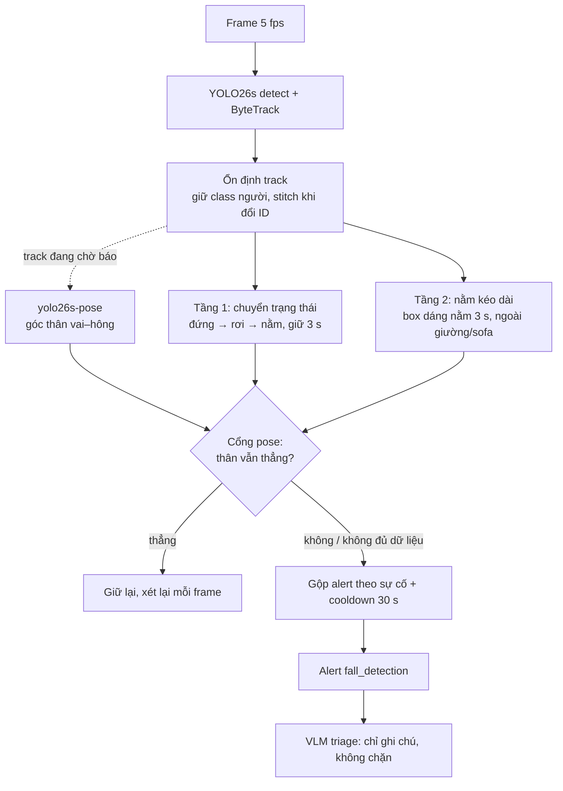

# Kiến trúc phát hiện té ngã

Tài liệu mô tả pipeline té ngã đang chạy trên nhánh `fix/vlm-triage-robustness` (commit `6d24a0f`,
2026-10-19): từng tầng làm gì, vì sao có nó, cấu hình ở đâu và đã đo được gì. Số liệu chi tiết
từng bước nằm ở [eval/results/report.md](../eval/results/report.md).

## 1. Tổng quan

Hệ thống không dùng mô hình phân loại "ngã / không ngã". Một detector YOLO tìm người, tracker giữ
ID qua các frame, và `RuleEngine` (`src/vision/rule_engine.py`) quyết định dựa trên lịch sử box
của từng track. PRD §3.1 yêu cầu người phải ở trạng thái ngã **quá 3 giây** mới báo, để nhặt đồ
hay cúi xuống không thành sự cố.

Có hai tầng phát hiện chạy song song cho mỗi track và một cổng pose đứng trước cả hai:

| Thành phần | File |
| --- | --- |
| Detector + tracker | `src/vision/detector.py`, `src/vision/trackers/bytetrack.yaml` |
| Optical flow thưa (bằng chứng phụ) | `src/vision/fall_motion.py` |
| Pose | `src/vision/fall_pose.py` |
| Hai tầng phát hiện, cổng pose, gộp alert | `src/vision/rule_engine.py` |
| Ghép các bước cho mỗi frame | `src/vision/pipeline.py` |
| Dựng pipeline theo cấu hình, mỗi camera một bản | `src/services/monitoring.py`, `src/vision/stream_manager.py` |
| Benchmark | `src/benchmark/run_fall_benchmark.py` |

## 2. Tầng 0 — detector và tracking

Phần lớn ca bỏ sót ban đầu không nằm ở luật mà ở tracking lúc người chạm sàn. Các sửa đổi:

- **ByteTrack được ghim** qua `src/vision/trackers/bytetrack.yaml`. Gọi `model.track()` không chỉ
  định tracker thì ultralytics 8.4 dùng TrackTrack (`new_track_thresh` 0.7), trong khi người nằm
  chỉ đạt điểm 0.3–0.6: không tạo được track mới, track cũ trượt khỏi khung theo vận tốc rơi.
- **Detection yếu vẫn vào tracker.** Tracker nhận detection từ `track_low_thresh` (0.1).
  `DETECTOR_CONFIDENCE` (0.4) chỉ chặn việc *tạo* track mới; một track đã có được tiếp tục dưới
  ngưỡng đó, nên người nằm điểm thấp không bị mất.
- **Giữ class người.** Tracker ghép box không phân biệt class, và YOLO hay gọi người nằm sàn là
  `bed`. Track đã từng là `person` thì vẫn là `person` (detector). Nếu một track vẫn đổi class, rule
  engine bỏ trạng thái cũ và bắt đầu lại để giường không "kế thừa" lịch sử của người.
- **Stitch khi đổi ID.** ID mới xuất hiện trong 2 s, gần box cũ, cùng class thì nhận lại trạng thái
  cũ (timer, baseline). Bán kính bình thường là 12% chiều rộng khung; khi track đang rơi/nằm, bán
  kính nới bằng chiều cao box cũ, vì tâm box tụt khoảng nửa thân người lúc ngã.

## 3. Tầng 1 — chuyển trạng thái đứng → nằm

Mỗi track người đi qua các pha `upright → descending → prone → persistent`, có thể về `recovered`.

**Baseline đứng.** Khi box hẹp (rộng/cao < 0.7), rule ghi trung vị 3 s gần nhất của đỉnh box, chiều
cao, tâm, diện tích. Không có baseline thì tầng này không arm — đó là lý do có tầng 2.

**Ba nhóm chỉ báo** (đo thay đổi trong cửa sổ 0.5 s, cần ≥ 2/3):

| Nhóm | Bật khi bất kỳ điều kiện nào đúng |
| --- | --- |
| Chuyển động | đỉnh box rơi ≥ 0.9 chiều cao/s; hoặc tâm rơi ≥ 0.35 H/s *và* diện tích tăng ≥ 30%; hoặc đỉnh tụt ≥ 18% baseline trong khi chân gần như đứng yên; hoặc optical flow hướng xuống ≥ 0.15 H/s |
| Hình dạng box | rộng/cao ≥ 1.2 |
| Biến dạng | chiều cao giảm ≥ 35%; hoặc diện tích tăng ≥ 30%; hoặc gia tốc diện tích ≥ 1.2/s² |

Optical flow (`fall_motion.py`) chỉ được tính cho track đã có dấu hiệu bất thường so với baseline,
nên cảnh đông người đi bình thường không tốn thêm CPU.

**Các pha:**

1. `upright → descending`: đủ 2/3 chỉ báo và đã có baseline. Box lúc này được ghi làm "box va chạm".
2. `descending → prone`: box nằm so với baseline (rộng/cao ≥ 1.2, hoặc thấp đi ≥ 35%, hoặc tâm tụt
   + diện tích tăng) liên tục 0.4 s. Không đạt trong 1 s thì huỷ về `upright`.
3. `prone`: đếm giờ từ lúc bắt đầu nằm. Người cựa quậy làm box không còn dáng nằm thì timer dừng;
   quá 0.6 s không nằm thì huỷ.
4. Đủ **3 s** → báo, chuyển `persistent`.
5. `recovered`: box trở lại đúng baseline đứng (cao, vị trí sai lệch ≤ 30%) **liên tục 0.6 s**. Một
   frame trông như đứng ngay sau lúc arm không được tính là đã đứng dậy — trước đây điều đó làm mất
   cú ngã thật ngay sau (UR Fall `fall-01`).

`reason` của alert ghi giá trị từng chỉ báo kể cả khi không bật (ví dụ `-AR=0.83(>=1.2)`), để VLM
và người vận hành biết vì sao rule kích hoạt.

## 4. Tầng 2 — nằm kéo dài

Tầng 1 cần thấy cả quá trình đứng → nằm trên cùng một track. Ngã từ ghế/giường không có baseline
đứng, và track chỉ xuất hiện khi người đã nằm thì không có chuyển đổi nào. Trên GMDCSA24, đây là
25/38 ca bước 1 còn bỏ sót.

Tầng 2 hỏi đơn giản hơn: box có dáng nằm (rộng/cao ≥ 1.2) liên tục **3 s** không, khi tầng 1 không
theo dõi cú ngã nào cho track đó. Không báo nếu ≥ 50% box người nằm trong box `bed`/`couch` (YOLO
nhận các lớp này qua `DETECTOR_TARGET_LABELS`; vị trí giường được nhớ 10 s vì detection chập chờn).
Mất dáng nằm quá 0.6 s thì timer reset; đứng dậy rồi nằm lại thì báo lại được.

Cái giá đã biết: một luật chỉ nhìn box không phân biệt được quỳ, ngồi xổm, nhặt đồ với nằm. Cổng
pose xử lý phần này.

## 5. Cổng pose — chặn khi thân người vẫn thẳng

Chỉ chạy khi có track đang chờ báo ngã (pha `descending`/`prone` chưa báo, hoặc box dáng nằm ở tầng
2), nên cảnh không ai ngã không tốn gì. Mỗi frame như vậy, `yolo26s-pose` chạy một lần trên frame,
mỗi pose được ghép với track có IoU ≥ 0.3, và rule lưu:

- góc đoạn trung điểm vai → trung điểm hông so với phương thẳng đứng (0° đứng, 90° nằm);
- có thấy cả đầu lẫn mắt cá hay không (keypoint conf ≥ 0.4).

Đến lúc một trong hai tầng sắp báo, xét các frame trong 3 s trước đó:

| Điều kiện | Kết quả |
| --- | --- |
| Không có dữ liệu pose, hoặc < 50% frame thấy toàn thân | **Báo** (không đủ bằng chứng thì không chặn) |
| ≥ 60% frame thấy toàn thân có thân nghiêng < 45° | **Giữ lại**, xét lại ở frame sau |
| Còn lại | **Báo**, `reason` kèm góc thân trung vị |

Frame chỉ thấy một phần người không được tính, vì góc thân của người bị khuất (ngã ra mép khung,
đầu ngoài khung) không nói gì về tư thế cả người. Alert bị giữ được xét lại mỗi frame, nên quỳ rồi
gục xuống vẫn được báo. Cổng này không bao giờ chặn tư thế nằm: ngủ trên giường hay hít đất không
được nó giải quyết.

Weights `src/vision/weights/yolo26s-pose.pt` không có trong repo (`*.pt` bị gitignore). Thiếu file
thì pipeline ghi cảnh báo và chạy không có cổng pose. Mỗi camera worker có model pose riêng vì
predictor của ultralytics không an toàn khi dùng chung giữa các thread.

## 6. Bộ lọc tốc độ rơi — có code, tắt mặc định

`fall_min_descent_speed` chặn cú ngã có tốc độ rơi đỉnh box thấp. Ngưỡng 0.5 H/s chọn trên UR Fall
+ GMDCSA24 có vẻ tốt, nhưng trên tập kiểm chứng CAUCAFall làm recall giảm 46% → 24%: ngã dàn dựng
chậm như chủ động nằm, và ngã về phía camera gần như không làm đỉnh box di chuyển. Giữ lại để dùng
làm tầng phụ cho ca khó; tốc độ rơi đo được luôn có trong `reason`.

## 7. Gộp alert và cooldown

Một người nằm sàn thường là nhiều track cùng lúc (box toàn thân, box một phần), và mỗi track tự
báo. Alert té ngã nằm gần (box nới 50%) một alert té ngã khác trên cùng camera trong cửa sổ
`ALERT_COOLDOWN_SEC` (30 s) bị bỏ; người ngã ở chỗ khác vẫn được báo. Trên benchmark, alert trùng
giảm 17 → 0. Sau đó cooldown thông thường theo track/label vẫn áp dụng.

## 8. VLM triage

Alert được gửi kèm đoạn clip trước sự cố cho VLM (`qwen-vl-plus` qua DashScope, bật bằng
`VLM_ENABLED`). VLM trả `real` / `false_positive` / `uncertain` và mô tả; kết quả chỉ được **ghi
chú** lên alert để bảo vệ xem, không bao giờ xoá alert. Benchmark ở mục 10 không dùng VLM.

## 9. Cấu hình

| Biến môi trường | Mặc định | Ý nghĩa |
| --- | --- | --- |
| `MODEL_WEIGHTS_PATH` | `src/vision/weights/yolo26s.pt` | Detector |
| `DETECTOR_CONFIDENCE` | 0.40 | Ngưỡng tạo track mới |
| `DETECTOR_TARGET_LABELS` | `person,backpack,handbag,suitcase,bed,couch` | `bed`, `couch` là ngữ cảnh cho tầng 2 |
| `FALL_POSE_WEIGHTS_PATH` | `src/vision/weights/yolo26s-pose.pt` | Cổng pose; rỗng hoặc thiếu file thì tắt |
| `ALERT_COOLDOWN_SEC` | 30 | Cooldown và cửa sổ gộp alert |
| `CAMERA_TARGET_FPS` | 5 | Tốc độ lấy mẫu |

Tham số của `RuleEngine` (không có biến môi trường, đổi trong code):

| Tham số | Mặc định | Ghi chú |
| --- | --- | --- |
| `fall_dwell_sec` | 3.0 | Yêu cầu PRD, không phải tham số để tinh chỉnh |
| `fall_aspect_ratio` / `fall_upright_aspect_ratio` | 1.2 / 0.7 | Nằm / đứng; khoảng giữa giữ nguyên timer |
| `fall_min_indicators` | 2 | Số nhóm chỉ báo cần đồng thuận |
| `fall_static_dwell_sec` | 3.0 | Tầng 2; 0 là tắt |
| `fall_furniture_overlap` | 0.5 | Tỷ lệ box nằm trong giường/sofa để bỏ qua |
| `fall_pose_upright_deg` / `_fraction` / `_min_coverage` | 45 / 0.6 / 0.5 | Cổng pose |
| `fall_min_descent_speed` | 0.0 | Tắt |

## 10. Kết quả đo

Ba bộ công khai, 329 clip, chấm theo clip, 5 fps, không VLM. Chạy lại:
`python -m src.benchmark.run_fall_benchmark --dataset {urfall,gmdcsa24,caucafall} --download`.

| Chỉ số | UR Fall | GMDCSA24 | CAUCAFall | Tổng |
| --- | --- | --- | --- | --- |
| Clip ngã / sinh hoạt | 30 / 40 | 78 / 81 | 50 / 50 | 158 / 171 |
| Recall | 86.7% | 78.2% | 70.0% | 77.2% |
| Specificity | 82.5% | 86.4% | 92.0% | 87.1% |
| Precision | 78.8% | 84.7% | 89.7% | 84.7% |
| F1 | 0.82 | 0.81 | 0.79 | 0.81 |
| Độ trễ từ lúc nằm đến lúc báo (trung vị) | 3.1 s | 3.9 s | 3.4 s | 3.7 s |

Đóng góp của từng tầng (recall gộp / số clip sinh hoạt bị báo nhầm): baseline 44.9–46.7% trên hai
bộ đầu → sửa tracking (bước 1) → thêm tầng 2 (bước 3) 78.5%, 37 clip → thêm cổng pose (bước 4)
77.2%, 22 clip.

Thời gian trên CPU dev, 720×480: detector ~81 ms/frame, pose ~89 ms mỗi lần chạy.

## 11. Hạn chế đã biết

- **Dữ liệu:** cả ba bộ quay trong nhà, phần lớn là ngã dàn dựng. Chưa có cảnh đông người, ngoài
  trời hay ngã thật. CAUCAFall là tập kiểm chứng cho bước 3 nhưng đã được xem khi chọn ngưỡng pose.
- **Người nằm thật vẫn bị báo:** ngủ trên giường khi tầng 1 kích hoạt (tầng 1 chưa kiểm tra giường),
  hít đất, nằm sàn — phần lớn trong 22 clip báo nhầm còn lại.
- **Tầng 1 đôi khi arm khi người vẫn đứng** (đi bộ, nhảy, box rộng/cao ~0.4). Cổng pose che được,
  nguyên nhân trong máy trạng thái chưa sửa.
- **Ngã chúi về trước và ngã về phía camera** khó nhất (CAUCAFall ngã về trước 5/10): box gần như
  không đổi hình dạng, và người sát mép khung thì detector mất hẳn.
- **Ngã kết thúc ở tư thế ngồi** bị cổng pose chặn theo thiết kế.
