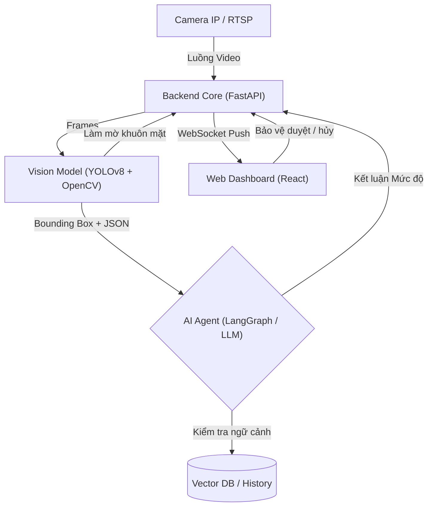

# PRODUCT REQUIREMENTS DOCUMENT

**Dự án:** Hệ Thống AI Agent Giám Sát Ngữ Cảnh & Phản Ứng Sự Cố An Ninh Khu Đô Thị
**Ngày cập nhật:** 02/08/2026  
**Đội ngũ phát triển:** Testing

---

## 1. TỔNG QUAN DỰ ÁN

### 1.1. Vấn đề

Lực lượng bảo vệ tại các khu đô thị đang bị quá tải khi phải giám sát hàng chục luồng camera cùng lúc. Hậu quả là các sự cố an ninh (đột nhập, cư dân té ngã, đồ vật nguy hiểm bị bỏ quên) thường bị phát hiện muộn. Các hệ thống cảm biến chuyển động hiện tại tạo ra quá nhiều báo động giả, gây "bội thực" cảnh báo.

### 1.2. Giải pháp đề xuất

Phát triển một hệ thống **AI Agent** hoạt động 24/7 trên Local Server. Hệ thống sử dụng Computer Vision để phát hiện sự kiện và LLM để suy luận ngữ cảnh, từ đó lọc báo động giả. Các cảnh báo thực sự nguy hiểm sẽ được đẩy lên Web Dashboard theo thời gian thực để bảo vệ xác nhận (HITL) trước khi kích hoạt báo động.

### 1.3. Đối tượng người dùng

- **Người dùng trực tiếp:** Nhân viên bảo vệ trực chốt (Sử dụng Web Dashboard để giám sát và thao tác).
- **Khách hàng:** Ban Quản lý Khu đô thị (Đơn vị hưởng lợi từ việc tối ưu chi phí và nâng cao an ninh).

---

## 2. KIẾN TRÚC HỆ THỐNG

---

## 3. TÍNH NĂNG CỐT LÕI & USER STORIES

### 3.1. Các nhãn nhận diện

Hệ thống tập trung vào 3 nhãn (labels) cốt lõi để giải quyết 3 bài toán ngách:

| Tính năng                                  | Mô tả Logic Xử lý                                                                                                       | User Story                                                                                    |
| :----------------------------------------- | :---------------------------------------------------------------------------------------------------------------------- | :-------------------------------------------------------------------------------------------- |
| **1. Phát hiện xâm nhập (`intrusion`)**    | Dùng Polygon Zone và Timestamp. Chỉ báo động khi có đối tượng đi vào ranh giới ảo trong khung giờ cấm (VD: 22h - 05h).  | Là bảo vệ, tôi muốn hệ thống tự khoanh vùng kẻ lạ đột nhập vào ban đêm để kịp thời ngăn chặn. |
| **2. Phát hiện té ngã (`fall_detection`)** | Theo dõi Bounding Box / Pose. Kích hoạt khi người duy trì trạng thái ngã/nằm quá 3 giây (Lọc hành động nhặt đồ).        | Là bảo vệ, tôi muốn nhận cảnh báo ngay khi có cư dân té ngã ở sảnh để gọi y tế khẩn cấp.      |
| **3. Đồ vật bỏ quên (`abandoned_object`)** | Detect hành lý/túi xách. Kích hoạt khi vật thể đứng yên và không có chủ nhân trong bán kính $R$ quá thời gian quy định. | Là quản lý, tôi muốn phát hiện sớm hành lý bị vứt lại để phòng ngừa rủi ro cháy nổ.           |

### 3.2. Cơ chế Xác nhận (Human-in-the-Loop - HITL)

- **Cảnh Báo:** Khi AI Agent đánh giá sự cố là "Nguy hiểm", Frontend sẽ hiển thị.
- **Thao tác:** Gồm 2 nút bấm to, rõ ràng: **[PHÁT BÁO ĐỘNG]** và **[BỎ QUA (Báo động giả)]**.
- **Logic:** Hệ thống chỉ được kích hoạt khi có sự xác nhận của bảo vệ.

### 3.3. Bảo mật Quyền riêng tư

- **Auto-Blur:** Toàn bộ khuôn mặt người xuất hiện trên luồng stream phải được làm mờ tự động thông qua OpenCV trước khi hiển thị lên UI.

---

## 4. YÊU CẦU PHI CHỨC NĂNG

| Hạng mục              | Ghi chú                                                         |
| :-------------------- | :-------------------------------------------------------------- |
| **Độ trễ**            | Thời gian từ lúc camera quay được đến khi Pop-up hiện trên Web. |
| **Độ chính xác**      | Đánh giá trên tập Validation cho 3 nhãn cốt lõi.                |
| **Giảm báo động giả** | Tỷ lệ lọc nhờ LLM và VectorDB.                                  |
| **Hiệu năng UI/UX**   | Phản hồi khi bảo vệ bấm nút Duyệt/Hủy. Giao diện Dark mode.     |

---

## 5. PHẠM VI NGOÀI DỰ ÁN

Để đảm bảo tiến độ PoC trong 6 tuần, dự án sẽ **KHÔNG** thực hiện:

- Nhận diện danh tính sinh trắc học cụ thể của từng cư dân (Face ID).
- Tự động hóa phần cứng vật lý (Tự động đóng cổng, xịt hơi cay).
- Multi-camera tracking (Theo dõi chéo một đối tượng đi qua nhiều camera khác nhau).

---
