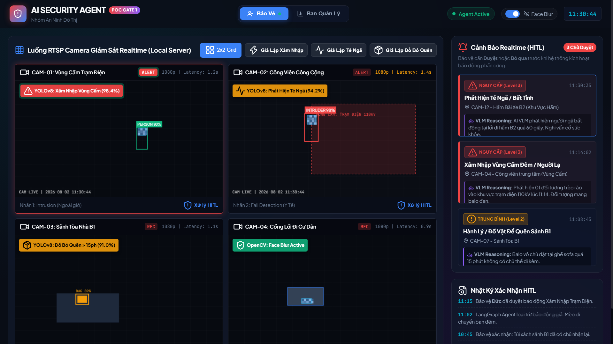
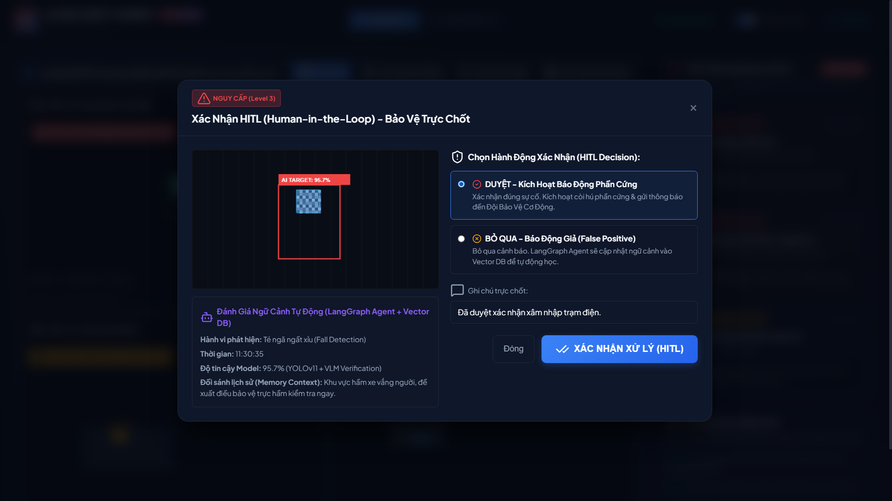
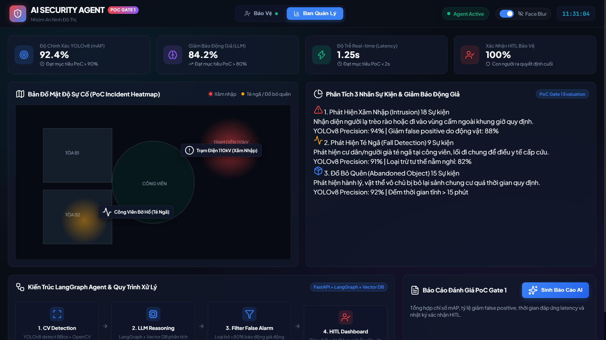

# WIREFRAME & UI FLOW

**Dự án:** Hệ Thống AI Agent Giám Sát Ngữ Cảnh & Phản Ứng Sự Cố An Ninh Khu Đô Thị
**Ngày cập nhật:** 02/08/2026

---

## Màn hình Lưới Camera (Grid View)

- **Mô tả:** Màn hình giám sát mặc định. Bên trái là lưới camera (Grid 2x2 hoặc 3x3). Bên phải là thanh Timeline hiển thị lịch sử các sự cố đã được ghi nhận.

---

## Màn hình Xác nhận HITL

- **Mô tả:** Khi AI Agent xác định có sự cố nghiêm trọng, luồng video sẽ bung thành một Pop-up nổi bật giữa màn hình. Kèm theo ảnh Bounding Box + `track_id` + `timestamp` là lời giải thích của AI (LLM Reasoning).

---

## Màn hình Quản Lý An Ninh & Thống Kê

- **Mô tả:** Nơi ghi nhận thông tin lịch sử cảnh báo chi tiết, bản đồ nhiệt về các khu vực thường xuyên xảy ra sự cố và thống kê.

