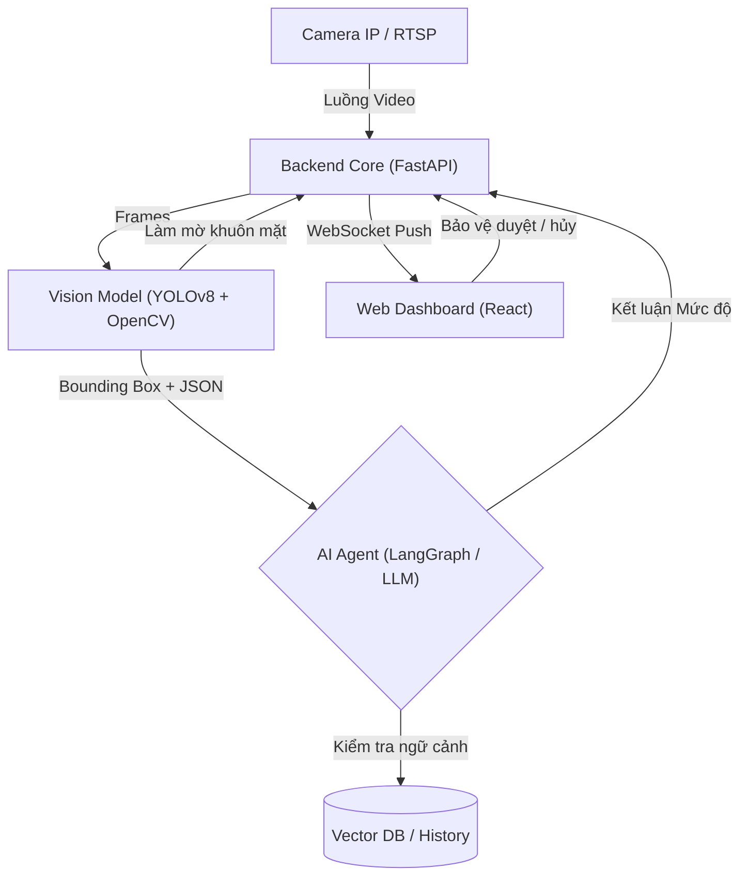

# Product Requirements Document
Ngày cập nhật: 02/08/2026

Đội ngũ phát triển: Testing

---

## 1. Tổng quan dự án

### 1.1. Vấn đề

Lực lượng bảo vệ tại các khu đô thị đang bị quá tải khi phải giám sát hàng chục luồng camera cùng lúc. Hậu quả là các sự cố an ninh (đột nhập, cư dân té ngã, đồ vật nguy hiểm bị bỏ quên) thường bị phát hiện muộn. Các hệ thống cảm biến chuyển động hiện tại tạo ra quá nhiều báo động giả, gây bội thực cảnh báo cho đội bảo vệ.

### 1.2. Giải pháp đề xuất

Phát triển một hệ thống AI Agent hoạt động 24/7 trên local server. Hệ thống dùng computer vision để phát hiện sự kiện, sau đó dùng LLM để suy luận ngữ cảnh nhằm lọc bớt báo động giả. Những cảnh báo được đánh giá là thực sự nguy hiểm mới được đẩy lên web dashboard theo thời gian thực, và bảo vệ phải xác nhận (HITL) trước khi hệ thống kích hoạt báo động.

### 1.3. Đối tượng người dùng

Người dùng trực tiếp là nhân viên bảo vệ trực chốt, sử dụng web dashboard để giám sát và thao tác xác nhận cảnh báo. Khách hàng là Ban Quản lý khu đô thị, đơn vị hưởng lợi từ việc tối ưu chi phí vận hành và nâng cao an ninh.

---

## 2. Kiến trúc hệ thống

---

## 3. Tính năng cốt lõi & user stories

### 3.1. Các nhãn nhận diện

Hệ thống tập trung vào 3 nhãn cốt lõi, tương ứng với 3 bài toán ngách:

| Tính năng | Mô tả logic xử lý | User story |
|---|---|---|
| Phát hiện xâm nhập | Dùng polygon zone và timestamp, chỉ báo động khi có đối tượng đi vào ranh giới ảo trong khung giờ cấm (VD: 22h - 05h) | Là bảo vệ, tôi muốn hệ thống tự khoanh vùng kẻ lạ đột nhập vào ban đêm để kịp thời ngăn chặn |
| Phát hiện té ngã | Theo dõi bounding box / pose, kích hoạt khi người duy trì trạng thái ngã/nằm quá 3 giây (tránh trường hợp nhặt đồ) | Là bảo vệ, tôi muốn nhận cảnh báo ngay khi có cư dân té ngã ở sảnh để gọi y tế khẩn cấp |
| Đồ vật bỏ quên | Detect hành lý/túi xách, kích hoạt khi vật thể đứng yên và không có chủ nhân trong vòng bán kính và quá thời gian quy định | Là quản lý, tôi muốn phát hiện sớm hành lý bị vứt lại để phòng ngừa rủi ro cháy nổ |

### 3.2. Cơ chế xác nhận

Khi AI Agent đánh giá một sự cố là nguy hiểm, frontend sẽ hiển thị cảnh báo với hai nút bấm to, rõ ràng: phát báo động hoặc bỏ qua. Hệ thống chỉ kích hoạt báo động phần cứng khi có sự xác nhận của bảo vệ, không tự động hành động một mình.

### 3.3. Bảo mật quyền riêng tư

Toàn bộ khuôn mặt người xuất hiện trên luồng stream được làm mờ tự động thông qua OpenCV trước khi hiển thị lên giao diện.

---

## 4. Yêu cầu phi chức năng

| Hạng mục | Ghi chú |
|---|---|
| Độ trễ | Thời gian từ lúc camera quay được đến khi thông báo hiện ra |
| Độ chính xác | Đánh giá trên tập validation cho 3 nhãn cốt lõi |
| Giảm báo động giả | Tỷ lệ lọc nhờ LLM và vector DB |
| Hiệu năng UI/UX | Phản hồi khi bảo vệ bấm nút duyệt/hủy |

---

## 5. Phạm vi ngoài dự án

Để đảm bảo tiến độ PoC trong 6 tuần, dự án sẽ không thực hiện:

- Nhận diện danh tính sinh trắc học cụ thể của từng cư dân (Face ID)
- Tự động hóa phần cứng vật lý (tự động đóng cổng, xịt hơi cay)
- Multi-camera tracking (theo dõi chéo một đối tượng đi qua nhiều camera khác nhau)
- Triển khai trên phần cứng