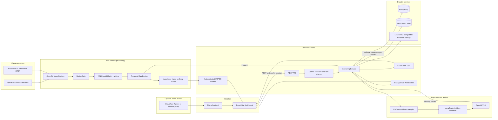

# P-091 Security Monitor Architecture

## Scope

P-091 is a multi-camera security monitoring system. It accepts uploaded videos,
local files, simulated RTSP streams, and IP-camera RTSP streams. Computer vision
detects incident candidates on the camera path. An asynchronous VLM workflow
reviews evidence after an incident is created; it is not required for every frame.

## System Diagram



## Runtime Components

| Component | Responsibility |
| --- | --- |
| React/Vite | Login, camera setup, zone polygons, live grid, alerts, and manager statistics |
| Nginx | Serves the compiled frontend and proxies API/stream requests |
| FastAPI/Uvicorn | Authentication, REST routes, MJPEG, SSE, manager WebSocket, and lifecycle APIs |
| `MonitoringService` | Camera registry, worker lifecycle, alert state, evidence collection, triage, and persistence |
| `MultiStreamManager` | Maintains independent capture, tracker, and rule state per camera |
| OpenCV | Reads file/RTSP sources, resizes inference frames, and encodes JPEG output |
| `MotionGate` | Skips inference on unchanged frames while preserving heartbeat updates |
| `IncidentDetector` | Runs `models/yolo26l.pt` with object tracking for configured labels |
| `RuleEngine` | Applies intrusion, fall, abandoned-object, temporal, and cooldown rules |
| LangGraph workflow | Runs post-alert evidence review asynchronously |
| OpenAI VLM | Reviews a bounded sequence of evidence frames and returns an advisory verdict |
| PostgreSQL | Production source of truth for users, sessions, camera configs, incidents, and reviewed alert history |
| Redis | Optional event relay for multiple backend/worker processes; it is not the history database |
| Evidence store | Stores alert JPEG evidence locally in `data/evidence` by default, or in S3-compatible storage when configured |
| Cloudflare Tunnel | Optional public ingress for demos; a named tunnel or VPS reverse proxy is required for reliable 24/7 hosting |

## Data Persistence

Production uses PostgreSQL when `APP_ENV=production` and `DATABASE_URL` is a
PostgreSQL URL. The important tables are:

- `users`: guard and manager accounts.
- `sessions`: server-side authenticated sessions.
- `camera_configs`: registered cameras and zone/rule configuration.
- `incidents`: every alert emitted by the rule engine, including evidence URL and review fields.
- `alert_history`: guard-reviewed/VLM-labelled alert history used for feedback and evaluation.

Alert evidence is stored separately from relational metadata. The default
production configuration uses the bind-mounted `./data` directory, with files in
`data/evidence`. For a cloud deployment, configure an S3-compatible backend and
keep PostgreSQL as the metadata source of truth.

Redis carries event notifications between processes when `REDIS_URL` is set. It
does not replace PostgreSQL and should not be treated as durable incident history.

## Incident Flow

1. A `StreamWorker` reads a file or RTSP frame.
2. `MotionGate` skips unchanged frames when no active track requires inference.
3. YOLO tracking runs on the configured inference size (default `640x640`) and emits detections and track IDs.
4. `RuleEngine` evaluates temporal state for intrusion, fall, and abandoned-object conditions.
5. When a rule fires, `MonitoringService` writes the incident to PostgreSQL, stores evidence asynchronously, and publishes `alert.created` through SSE.
6. The worker keeps a bounded ring buffer. The asynchronous LangGraph workflow samples pre/post frames and calls the OpenAI VLM when enabled.
7. The VLM returns `real`, `false_positive`, or `uncertain` as an advisory result. It cannot suppress the deterministic incident record.
8. The guard records the final verdict. The incident and labelled history remain queryable after a page refresh or backend restart.

## Transport and Authentication

- REST API: `/api/v1/*`.
- Live video: authenticated MJPEG at `/api/v1/cameras/{camera_id}/stream`.
- Guard alerts: authenticated Server-Sent Events at `/api/v1/events`.
- Manager live updates: authenticated WebSocket at `/api/v1/manager/live`.
- Sessions: HttpOnly cookie with guard/manager role enforcement.
- Health check: `GET /health`.

The browser activity rail is initially loaded from `GET /api/v1/alerts`; it is not
only an in-memory frontend list. New events are then merged through SSE.

## Intrusion Rule

Intrusion is a rule decision, not a YOLO class. YOLO detects `person`; the rule
checks the person's bottom-center foot point, with a lower-body overlap fallback,
against an enabled polygon and time window. A cooldown prevents repeated alerts
for the same camera and incident type.

## Deployment Topology

Local production currently runs with Docker Compose:

```text
frontend (Nginx) -> backend (FastAPI/Uvicorn) -> PostgreSQL
                                      |          -> Redis
                                      |          -> local/S3 evidence
                                      -> NVIDIA GPU when available
```

The backend and frontend are separate containers. PostgreSQL and Redis use
persistent host volumes. The model is mounted read-only at
`/app/models/detector.pt`. A public Cloudflare Quick Tunnel can expose the
frontend for testing, but it depends on the local host remaining online and its
URL is not permanent.

For 24/7 deployment, move the Compose stack to an always-on VPS or GPU cloud
instance, use a named tunnel or HTTPS reverse proxy, configure a fixed domain,
and place evidence in durable object storage.

## Known Constraints

- CPU-only instances can run the stack but have limited YOLO throughput.
- `yolo26l.pt` is unchanged; performance improvements come from inference resizing, motion gating, and concurrency configuration.
- RTSP sources must be reachable from the deployment host, usually through a VPN when cameras are on a private network.
- MJPEG preview bandwidth grows quickly with camera count and viewer count; production deployments should consider lower preview FPS or HLS/WebRTC.
