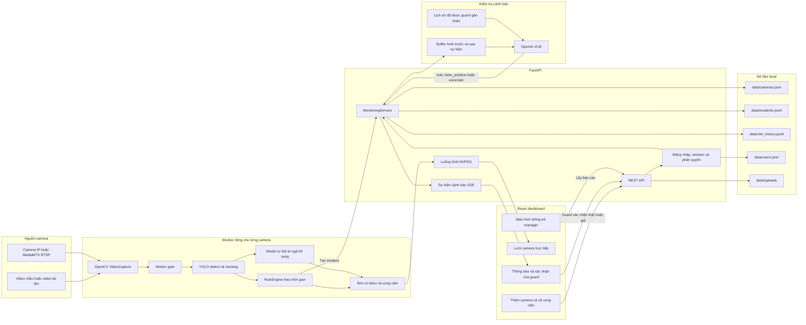

# Kiến trúc hệ thống

## Sơ đồ thành phần và luồng dữ liệu



## Các thành phần đang chạy

| Thành phần            | Vai trò trong hệ thống                                                |
| --------------------- | --------------------------------------------------------------------- |
| React/Vite            | Giao diện đăng nhập, camera, cảnh báo và thống kê                     |
| FastAPI               | API, phân quyền, MJPEG, SSE và quản lý vòng đời camera                |
| `MonitoringService`   | Nối API với vision pipeline, giữ buffer hình và chạy VLM ở background |
| `MultiStreamManager`  | Tạo worker, tracker và rule state riêng cho từng camera               |
| OpenCV                | Đọc video/RTSP, resize và mã hóa ảnh JPEG                             |
| YOLO                  | Nhận diện và bám theo `person`, `backpack`, `handbag`, `suitcase`     |
| `RuleEngine`          | Đánh giá té ngã, xâm nhập, đồ vật bỏ quên và cooldown cảnh báo        |
| `FallPostureDetector` | Model té ngã bổ sung; không tham gia phát hiện xâm nhập               |
| OpenAI VLM            | Xem bằng chứng hình ảnh và đánh giá lại cảnh báo                      |
| JSON/JSONL            | Lưu camera, tài khoản, incident và kết quả guard/VLM                  |
| MediaMTX              | Thành phần ngoài hệ thống, chỉ dùng khi cần giả lập RTSP              |

## Luồng xử lý một cảnh báo

1. `StreamWorker` đọc frame từ video hoặc RTSP.
2. `MotionGate` bỏ qua một số frame khi cảnh không thay đổi và không có track đang hoạt động.
3. YOLO nhận diện vật thể với ngưỡng `DETECTOR_CONFIDENCE`, hiện là `0.40`, đồng thời cấp
   `track_id` để theo dõi cùng một người hoặc đồ vật qua nhiều frame.
4. `RuleEngine` nhận detection và kiểm tra điều kiện của từng sự kiện:
   - Intrusion: điểm chân hoặc phần thân dưới đi vào polygon đang hoạt động.
   - Fall: thay đổi chuyển động/hình dạng kéo dài đủ thời gian, hoặc model tư thế té ngã xác nhận.
   - Abandoned object: đồ vật đứng yên và không còn người ở gần trong thời gian quy định.
5. Khi rule phát cảnh báo, backend gửi `alert.created` qua SSE để giao diện hiện thông báo ngay.
6. Backend đợi đủ phần hình sau sự kiện, lấy tối đa 6 frame từ ring buffer rồi gọi OpenAI.
7. VLM trả verdict, confidence, lý do và nhận xét cho từng frame. Kết quả được gửi lại qua
   `alert.verdict`.
8. Guard chọn sự kiện thật hoặc báo động giả. Dòng kết quả này được ghi vào
   `data/vlm_history.jsonl` và được dùng làm ví dụ cho những lần đánh giá sau.

## Phát hiện xâm nhập

Intrusion không phải là một class riêng của YOLO. YOLO chỉ nhận diện `person`. Rule chỉ chạy
khi camera đã bật Intrusion và có polygon hợp lệ.

Điều kiện hiện tại:

```text
YOLO thấy person và có track_id
AND vùng cấm đang trong giờ hoạt động
AND điểm chân nằm trong polygon
    OR ít nhất 25% số điểm mẫu ở thân dưới nằm trong polygon
THEN tạo cảnh báo intrusion
```

Cảnh báo có thể xuất hiện ngay ở frame đầu tiên người được nhìn thấy trong vùng. Không bắt buộc
phải thấy họ ở ngoài trước. Khi người rời vùng, track đó được mở lại để có thể cảnh báo nếu họ
đi vào lần nữa. Cooldown mặc định là 30 giây cho cùng một loại cảnh báo trên cùng camera.

Confidence hiển thị trên cảnh báo intrusion là confidence của detection `person`, không phải
xác suất "đây chắc chắn là hành vi xâm nhập".

## VLM nằm ở đâu trong luồng

VLM không xem camera liên tục. Nó chỉ được gọi sau khi vision rule đã tạo incident. Input gồm:

- Tên camera và loại sự kiện
- Lý do rule đã kích hoạt
- Tối đa 6 frame theo thứ tự thời gian, có cả trước và sau cảnh báo
- Các ví dụ cũ cùng camera và cùng loại sự kiện đã được guard xác nhận

Output gồm verdict `real`, `false_positive` hoặc `uncertain`, confidence, một câu giải thích và
nhận xét quan sát được ở từng frame.

Với kết quả `false_positive` có confidence từ 85% trở lên, frontend không mở popup lớn. Cảnh
báo vẫn còn trong lịch sử, không bị xóa. Các kết quả thật, chưa chắc chắn hoặc false positive
dưới 85% vẫn cần guard xem lại.
