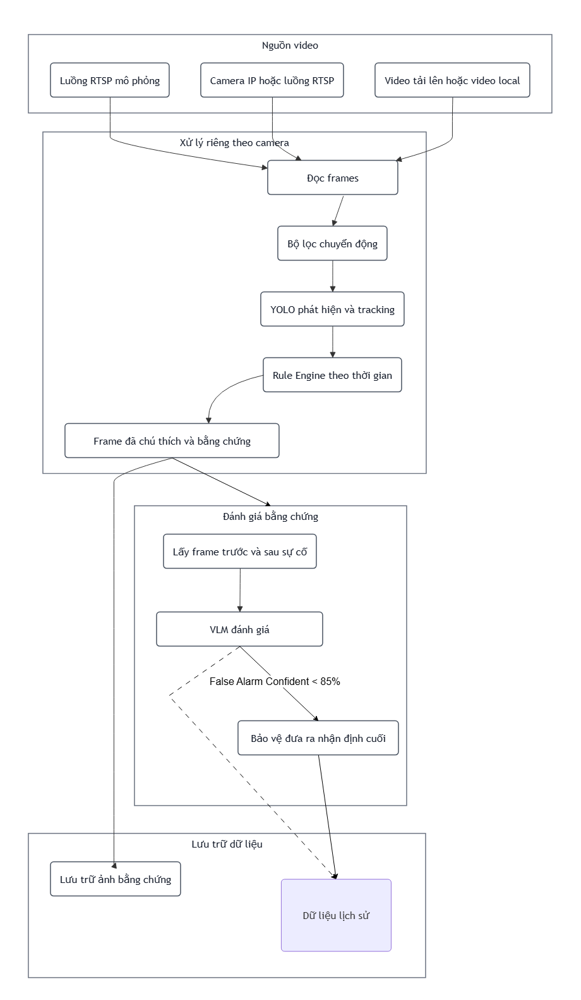
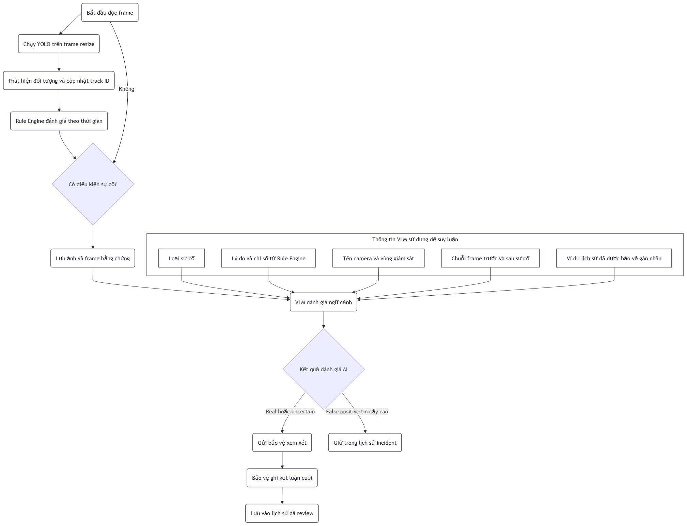

# Kiến trúc

## 1. Mục đích hệ thống

Hệ thống có hai giai đoạn xử lý chính:

1. **Computer Vision:** phát hiện và theo dõi đối tượng trên từng camera, sau đó áp dụng các rule theo thời gian.
2. **Đánh giá bằng chứng:** VLM phân tích ngữ cảnh sau khi Rule Engine tạo cảnh báo.

## 2. Sơ đồ kiến trúc tổng thể

Sơ đồ mô tả mối quan hệ giữa nguồn video, pipeline xử lý riêng theo camera, bước
đánh giá bằng chứng và lớp lưu trữ dữ liệu.



## 3. Sơ đồ luồng xử lý và đánh giá sự cố

Sơ đồ thể hiện luồng từ khi đọc frame đến khi Rule Engine phát hiện sự cố, VLM đánh
giá ngữ cảnh và hệ thống quyết định cảnh báo nào cần gửi cho bảo vệ xem xét.



VLM sử dụng các thông tin sau để suy luận:

- Loại sự cố.
- Lý do và chỉ số do Rule Engine cung cấp.
- Tên camera và vùng giám sát.
- Chuỗi frame trước và sau thời điểm xảy ra sự cố.
- Các ví dụ lịch sử cùng camera và loại sự cố đã được bảo vệ gán nhãn.

Mọi cảnh báo được lưu trong lịch sử incident. Kết quả `real` hoặc `uncertain` được
gửi cho bảo vệ xem xét. `False positive` có độ tin cậy cao có thể không hiển thị
popup lớn nhưng vẫn được giữ trong lịch sử. Chỉ verdict do bảo vệ xác nhận mới được
ghi vào lịch sử đã review.

## 4. Pipeline xử lý camera

Mỗi camera có worker, tracker và trạng thái Rule Engine độc lập:

```text
Video Source
    -> OpenCV Frame Capture
    -> Motion Gate
    -> YOLO Detection and Tracking
    -> Temporal Rule Engine
    -> Annotated Frame and Evidence Buffer
    -> Incident Record
```

## 5. Các loại sự cố

### 5.1. Xâm nhập

YOLO phát hiện đối tượng `person`; Rule Engine quyết định có xảy ra xâm nhập hay
không. Rule kiểm tra điểm chân của người, hoặc vùng overlap phần thân dưới khi bị
che khuất, có nằm trong polygon đang hoạt động và đúng khung giờ quy định hay không.

### 5.2. Té ngã

Rule Engine đánh giá thay đổi tư thế, chuyển động và hình dạng bounding box qua
nhiều frame. Điều kiện thời gian giúp hạn chế cảnh báo do chuyển động ngắn hoặc tư
thế tạm thời.

### 5.3. Đồ vật bị bỏ quên

Hệ thống theo dõi túi hoặc hành lý, sau đó kiểm tra vật thể có đứng yên trong thời
gian quy định mà không còn chủ sở hữu ở gần hay không.
