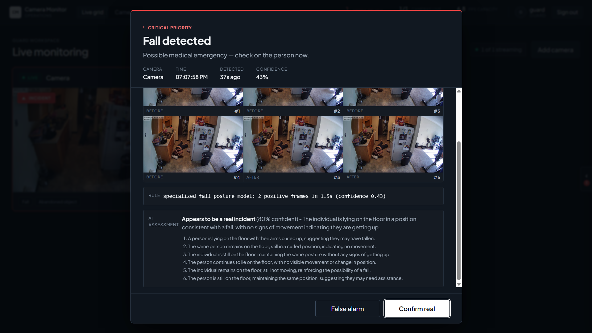
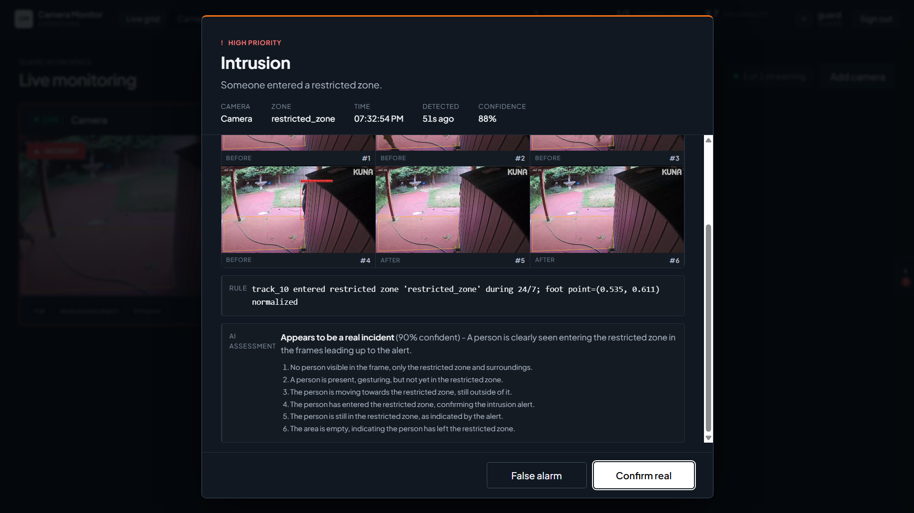
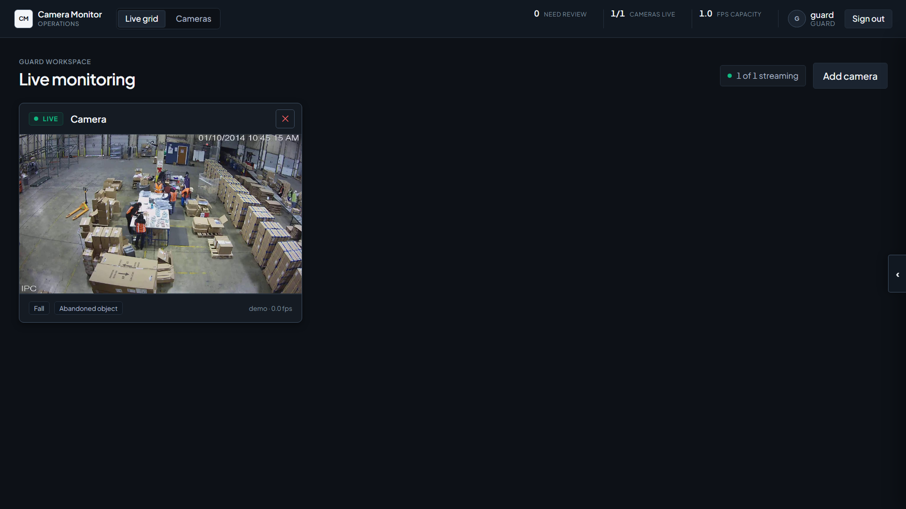
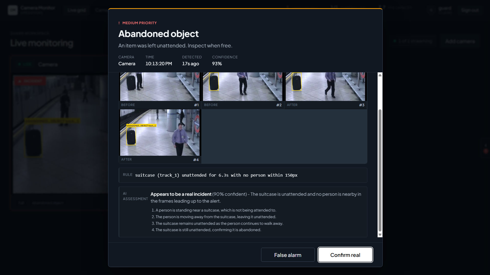

# Kết quả test thủ công Gate 2

## Tóm tắt

| STT | Tình huống                      | Kết quả mong đợi                 | Kết quả thực tế                                        | Đánh giá |
| --- | ------------------------------- | -------------------------------- | ------------------------------------------------------ | -------- |
| 1   | Người té ngã và nằm yên         | Cảnh báo fall, VLM xác nhận thật | Fall 43%, VLM `real` 80%                               | Đạt      |
| 2   | Người tập push-up               | Không coi là té ngã              | Vision phát fall 43%; VLM nhận ra `false_positive` 70% | Đạt      |
| 3   | Người đi vào vùng cấm           | Cảnh báo intrusion               | Intrusion 88%, VLM `real` 90%                          | Đạt      |
| 4   | Hoạt động bình thường trong kho | Không có cảnh báo cần xử lý      | Dashboard hiển thị `0 need review`                     | Đạt      |
| 5   | Cảnh có vali bị bỏ lại          | Cảnh báo abandoned object        | abandoned 93,4%, VLM `real` 90%                        | Đạt      |

## Case 1 - Té ngã thật

**Input:** Video có người ngã trong bếp rồi nằm yên trên sàn.

**Mong đợi:** Vision tạo cảnh báo `fall_detection`; VLM xác nhận đây là sự kiện thật.

**Output thực tế:**

- Specialized fall posture model nhận diện 2 frame dương tính trong 1,5 giây.
- Confidence của vision alert: 43%.
- VLM: `real`, confidence 80%.
- VLM nhận xét người nằm trên sàn, tư thế phù hợp với té ngã và không có dấu hiệu đứng dậy.

**Kết luận:** Đạt. Vision bắt được sự kiện và VLM đọc đúng trạng thái sau khi ngã.

## Case 2 - Push-up bị nhận nhầm là té ngã

**Input:** Người cúi xuống rồi chuyển sang tư thế chống đẩy.

**Mong đợi:** Không chuyển thành cảnh báo y tế cần xử lý.

**Output thực tế:**

- Specialized fall posture model phát cảnh báo ở confidence 43%.
- VLM trả `false_positive`, confidence 70%.
- VLM mô tả đúng chuỗi hành động: đứng, cúi xuống, chuyển tư thế rồi tập push-up.

**Kết luận:** Đạt. VLM phân biệt được tập thể dục với té ngã.

.png>)

## Case 3 - Xâm nhập vùng cấm

**Input:** Một người đi từ ngoài vào polygon `restricted_zone`.

**Mong đợi:** Tạo cảnh báo intrusion khi người bước vào vùng.

**Output thực tế:**

- Vision tạo cảnh báo `intrusion` với confidence của person detection là 88%.
- Rule ghi nhận `track_10`, foot point chuẩn hóa `(0.535, 0.611)` nằm trong vùng cấm.
- VLM trả `real`, confidence 90%.
- Chuỗi 6 frame cho thấy người ở ngoài, tiến gần, đi vào vùng rồi rời khỏi khung hình.

**Kết luận:** Đạt. Rule polygon và VLM cùng đưa ra kết quả đúng.

## Case 4 - Hoạt động bình thường

**Input:** Camera nhà kho có nhiều người làm việc và nhiều thùng hàng.

**Mong đợi:** Không tạo cảnh báo fall hoặc abandoned object khi chưa đủ điều kiện.

**Output thực tế:**

- Camera vẫn streaming.
- Dashboard hiển thị `0 need review`.
- Không có popup cảnh báo tại thời điểm chụp.

**Kết luận:** Đạt trong thời gian quan sát của test. Case này chứng minh output "không cảnh báo"
tại thời điểm chạy.

## Case 5 - Vali bị bỏ lại

**Input:** Cảnh nhà ga có vali đứng yên và người đi khỏi khu vực.

**Mong đợi:** Tạo cảnh báo `abandoned_object` và VLM xác nhận đồ vật không có chủ ở gần.

**Output thực tế trong log:**
Camera trong ảnh tạo một abandoned alert cho `suitcase track_19`, confidence 93,3%, VLM `real` 90%.

**Kết luận:** Đạt theo log end-to-end: detector tạo đúng nhãn, rule ghi đúng thời gian không có
người ở gần, VLM xác nhận thật.

## Video demo

[Xem video trên Google Drive](https://drive.google.com/file/d/1DwTT9Bh_V6_9cmfgZGWwqVtIRbyloHsS/view?usp=sharing)
