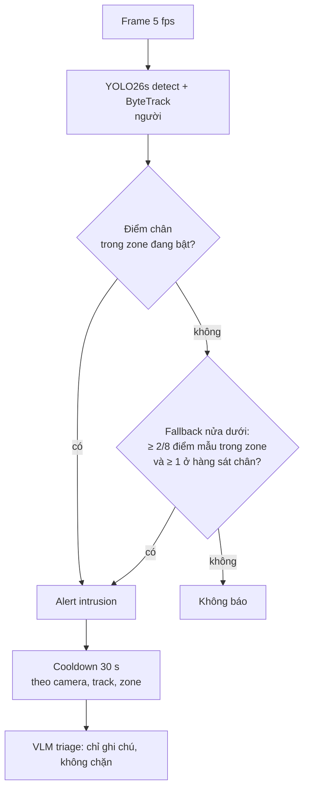

# Kiến trúc phát hiện xâm nhập vùng cấm

Tài liệu mô tả rule xâm nhập đang chạy trên `develop` (PR #5, 2026-10): nó làm gì, vì sao, cấu hình
ở đâu và đã đo được gì. Số liệu chi tiết từng bước nằm ở
[eval/results/report.md](../eval/results/report.md#benchmark-xâm-nhập).

## 1. Tổng quan

PRD yêu cầu báo khi có người đi vào ranh giới ảo trong khung giờ cấm. Không có mô hình "xâm nhập":
YOLO tìm người, ByteTrack giữ ID, và `RuleEngine._check_intrusion` (`src/vision/rule_engine.py`) xét
**điểm chân** của từng người so với polygon của zone.

| Thành phần | File |
| --- | --- |
| Detector + tracker | `src/vision/detector.py` |
| Zone, khung giờ, point-in-polygon | `src/vision/zone_config.py`, `src/vision/schemas.py` (`Zone`) |
| Rule | `src/vision/rule_engine.py` (`_check_intrusion`, `_apply_cooldown`) |
| Zone vẽ trên giao diện, mỗi camera một zone | `src/services/monitoring.py` (`_apply_zones`) |
| VLM triage | `src/services/vlm.py`, `src/services/monitoring.py` (`_collect_clip`) |
| Benchmark | `src/benchmark/run_intrusion_benchmark.py` |

## 2. Zone

- Người vận hành bật xâm nhập cho từng camera và vẽ polygon trên giao diện (`intrusion_enabled`,
  `zone_polygon`, `zone_active_hours`). `MonitoringService._apply_zones` cài nó thành một zone
  `restricted_zone`. Camera tắt xâm nhập nhận danh sách zone rỗng, để không thừa hưởng zone `"*"`.
- Toạ độ chuẩn hoá về [0, 1]. Polygon có thể lõm; phép thử là ray-casting
  (`point_in_polygon`), nên một lỗ trong zone làm được bằng khe rộng 0 px (xem mục 6).
- **Khung giờ cấm** dạng `22:00-05:00`, được phép qua nửa đêm. Không đặt thì zone bật 24/7.
  Chuỗi sai bị từ chối ngay khi cấu hình (`validate_active_hours`), không âm thầm thành 24/7.
- `data/vision/zones.json` vẫn được đọc (`ZoneManager.from_file`), với khoá `"*"` cho camera chưa
  cấu hình.

## 3. Rule

**Điểm chân** là trung điểm cạnh dưới box người: chỗ người đứng, cũng là thứ zone được vẽ quanh.
Dùng tâm box thì thân người đè qua mép zone sẽ báo sớm.

**Fallback nửa dưới**, chỉ khi điểm chân ở ngoài: 8 điểm mẫu ở 72% và 92% chiều cao box (x ở 20, 40,
60, 80% bề rộng). Báo khi:

- ≥ 2/8 điểm trong zone — xấp xỉ 25% nửa dưới, dành cho người bị che một phần hay cầm ô làm điểm
  chân không tin được; và
- ≥ 1 trong số đó ở **hàng 92%** (sát chân).

Điều kiện thứ hai là kết quả benchmark. Chỉ hàng 72% trong zone nghĩa là chân đứng trước zone và
thân che mép xa của nó — người đi trên hành lang trước cửa kính, nhìn từ trên xuống. Đó là 48/50 báo
nhầm của fallback ở `caviar-front`, và cảnh báo sớm đó còn dùng mất lần báo của track, nên lúc người
vào thật thì không báo nữa. Đứng chéo qua mép bên của zone, ca fallback được làm ra để bắt, có điểm
ở cả hai hàng.

**Báo một lần, báo ngay:**

- Báo ở frame đầu tiên người ở trong vùng, không có thời gian dừng (dwell).
- Mỗi track báo một lần cho mỗi zone. Ra khỏi vùng (dù 1 frame) là được báo lại khi vào lại.
- Cooldown `ALERT_COOLDOWN_SEC` (30 s) theo khoá (camera, nhãn, track, zone), áp ở lối ra duy nhất
  của `evaluate`.

`reason` ghi tên track, zone, khung giờ và bằng chứng: toạ độ điểm chân đã chuẩn hoá, hoặc
`lower-body overlap confirmed by at least 2/8 samples`. Đây là thứ người trực và VLM đọc.

## 4. VLM triage

Như các loại cảnh báo khác: bật bằng `VLM_ENABLED`, trả `real` / `false_positive` / `uncertain` và
chỉ **ghi chú** lên alert. Hướng dẫn riêng cho `intrusion` trong `src/services/vlm.py`: chỉ `real` khi
người thực sự vượt vào vùng; đi ngang bên ngoài không phải xâm nhập; ranh giới không rõ thì
`uncertain`.

Clip gửi VLM là 4 frame trong 5 s trước và 2 frame trong 2 s sau lúc báo, **cắt quanh người** của
cảnh báo, và **không vẽ zone**. Model vì vậy không thấy ranh giới. Thử 10 cảnh báo của benchmark với
`qwen3-vl-plus` (không phải benchmark): 5/10 trả `uncertain`, model tự nói ranh giới không rõ; chỉ
1/6 báo nhầm được nhận ra. Benchmark xâm nhập không dùng VLM.

## 5. Cấu hình

| Biến / trường | Mặc định | Ý nghĩa |
| --- | --- | --- |
| `intrusion_enabled` (camera) | false | Bật xâm nhập cho camera |
| `zone_polygon` (camera) | — | Polygon, toạ độ chuẩn hoá |
| `zone_active_hours` (camera) | không đặt (24/7) | Khung giờ cấm `HH:MM-HH:MM` |
| `DETECTOR_CONFIDENCE` | 0.4 | Ngưỡng detection |
| `ALERT_COOLDOWN_SEC` | 30 | Cooldown theo camera, nhãn, track, zone |
| `CAMERA_TARGET_FPS` | 5 | Tốc độ phân tích |

Tham số không có biến môi trường (đổi trong code, `_check_intrusion`): hàng điểm mẫu 0.72 và 0.92,
cột 0.2/0.4/0.6/0.8, ngưỡng 2 điểm, ít nhất 1 ở hàng 0.92.

## 6. Kết quả đo

CAVIAR Lisbon (camera trước và camera hành lang, cùng 26 clip) + 3 chuỗi MOT15: 224 lần vào vùng,
51 phút, chấm theo lần vào, 5 fps, không VLM. Chạy lại:
`python -m src.benchmark.run_intrusion_benchmark --dataset all --label <nhãn>`. Tải dữ liệu một lần
bằng `--download` (khoảng 2 GB).

| Chỉ số | caviar-front | caviar-corridor | MOT15 | Tổng |
| --- | --- | --- | --- | --- |
| Lần vào vùng | 72 | 101 | 51 | 224 |
| Recall | 59/72 (82%) | 83/101 (82%) | 43/51 (84%) | 185/224 (83%) |
| Precision | 94% | 87% | 81% | 87% |
| Báo nhầm | 4 | 13 | 10 | 27 |
| Người đi dọc mép bị báo | 2/27 | 9/23 | 6/15 | 17/65 |
| Độ trễ sau lúc vào (trung vị) | 0.4 s | 0.2 s | −0.1 s | |

Trên cùng bộ nhãn, trước khi sửa fallback: recall 162/224 (72%), precision 67%, 81 báo nhầm.

**Nhãn là nhãn tự suy ra**, không phải ground truth gốc: không bộ nào có nhãn xâm nhập. Mỗi camera
có một zone vẽ tay, và một người "vào vùng" khi điểm chân box ground-truth của họ ở trong zone
≥ 0,4 s. Zone của `caviar-front` có một lỗ quanh một ma-nơ-canh YOLO gọi là người; đó là lỗi đặt
zone, không phải lỗi rule (`SHOP_ZONE_PX`). **Điều kiện hàng sát chân được chọn sau khi xem chính
các clip này**, nên số liệu lạc quan hơn thực tế.

## 7. Hạn chế đã biết

- **Zone hẹp dọc lối đi:** người đi sát dải 35 px ở `caviar-corridor` vẫn bị báo (9/23); chân và
  mép box đè lên dải, hình học không tách được với người vào thật.
- **Đổi track ID trong vùng** gây báo trùng (15 trên benchmark). Gộp theo vị trí đã thử và bị bỏ:
  biến thể tốt nhất mất 3 lần vào thật để bớt 2 báo trùng.
- **Không có dwell:** người bước qua mép rồi lùi lại ngay vẫn bị báo. Dwell 0,4 s làm chậm cảnh báo;
  PRD không đặt ngưỡng độ trễ, chưa quyết.
- **Vật YOLO gọi là người** trong zone (ma-nơ-canh, tượng, áo treo) báo lại ở mỗi track mới. Cách
  hiện tại là vẽ zone tránh nó.
- **39 lần vào bị sót** chưa được phân loại (YOLO không thấy sau kính, điểm chân bị che, track sinh
  muộn).
- **VLM không thấy zone** (mục 4).
- **Dữ liệu:** 3 cảnh camera, nhãn suy ra, ngưỡng không có tập kiểm chứng độc lập.
