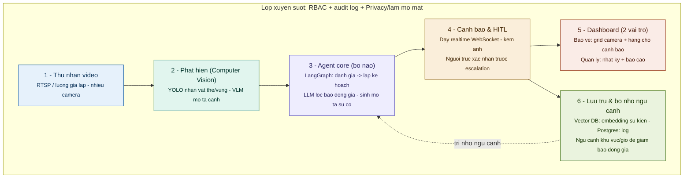

# SC-03 — Tổng quan dự án

## 1. Pitch & Bối cảnh

**SC-03: AI Agent Giám Sát & Cảnh Báo An Ninh Từ Camera AI Khu Đô Thị** — một PoC trong khuôn khổ cuộc thi AI20K Build Phase (Cohort 2), xây dựng hệ thống AI Agent tự động phân tích luồng camera an ninh, phát hiện sự kiện bất thường, đánh giá mức độ nghiêm trọng và phối hợp với con người để ra quyết định phản ứng.

---

## 2. Thực trạng & Nỗi đau

Khu đô thị hiện đại có hàng trăm camera an ninh, nhưng đội bảo vệ chỉ có vài người — không ai có thể giám sát đồng thời hàng chục màn hình liên tục 24/7. Hệ quả: phần lớn sự cố an ninh (đột nhập, người lạ, tụ tập bất thường, vật thể bỏ lại) chỉ được phát hiện **sau khi xảy ra**, khi nhân viên xem lại bản ghi. Camera trở thành công cụ **truy vết sự việc đã qua**, thay vì **phòng ngừa và phản ứng kịp thời**.

---

## 3. Định nghĩa vấn đề

### Vấn đề 1

Khả năng chú ý của con người không scale theo số lượng camera. Khi khu đô thị mở rộng từ 50 lên 200 camera, bảo vệ vẫn chỉ có thể theo dõi hiệu quả 4–6 màn hình. Phần còn lại là điểm mù.

### Vấn đề 2

Nếu giải bài toán trên một cách ngây thơ (gắn motion detection hoặc rule-based alert cho mọi camera), ta không giải quyết vấn đề — ta chỉ **đổi "không xem xuể" thành "ngập báo động giả"**. Bảo vệ nhận 200 alert/giờ sẽ bỏ qua tất cả, và hệ thống trở nên vô dụng.

**Insight:** False positive không phải bài toán nâng cao để làm sau — nó là **lõi** của toàn bộ hệ thống. Một hệ thống phát hiện chính xác 95% nhưng tạo 100 false positive mỗi ngày sẽ bị bảo vệ tắt trong tuần đầu tiên.

### Problem statement

> Xây dựng AI Agent có khả năng giám sát luồng camera khu đô thị, phát hiện sự kiện bất thường với **tỷ lệ báo động giả đủ thấp để người dùng tin tưởng**, tự đánh giá mức độ nghiêm trọng, lập kế hoạch phản ứng phù hợp, và đảm bảo **con người luôn là người ra quyết định cuối cùng** đối với các hành động ảnh hưởng lớn.

---

## 4. Người dùng & Stakeholder

| Vai trò | Phân loại | Nỗi đau chính |
|---------|-----------|----------------|
| **Bảo vệ trực** | User chính | Không thể theo dõi hết camera; cần cảnh báo đáng tin, không bị ngập alert vô nghĩa |
| **Quản lý an ninh** | User giám sát | Thiếu bức tranh tổng thể; cần báo cáo xu hướng, thống kê sự cố theo khu vực/thời gian |
| **Cư dân** | Stakeholder (không dùng trực tiếp) | Rủi ro cao nhất về quyền riêng tư — là lý do tồn tại của mọi ràng buộc privacy trong hệ thống |
| **Chủ đầu tư** | Stakeholder (người trả tiền) | Cần ROI rõ ràng: giảm nhân sự giám sát, giảm thời gian phản ứng, giảm thiệt hại do sự cố |

---

## 5. Ràng buộc sống còn

Bốn ràng buộc dưới đây không phải checklist để tick — chúng **định hình kiến trúc** của toàn bộ hệ thống. Bỏ bất kỳ trục nào, hệ thống sẽ không hoạt động được trong thực tế.

### 5.1. HITL (Human-in-the-Loop)

Mọi hành động escalation nghiêm trọng (báo động cấp cao, khóa cổng, gọi công an) **phải qua người trực xác nhận**. AI đề xuất, con người quyết định. Ràng buộc này định hình toàn bộ agent flow — agent không được phép tự thực thi hành động có hệ quả lớn, luôn phải dừng lại ở bước HITL trước khi escalate.

### 5.2. Privacy & Bảo mật dữ liệu

Dữ liệu hình ảnh khuôn mặt cư dân là **cực kỳ nhạy cảm**. Hệ thống phải: làm mờ khuôn mặt trong mọi ảnh hiển thị/lưu trữ, phân quyền chặt chẽ (bảo vệ chỉ xem được khu vực phụ trách), audit log mọi truy cập. Ràng buộc này định hình data pipeline — từ cách thu nhận, xử lý, đến lưu trữ và hiển thị.

### 5.3. Precision & Kiểm soát false positive

Như đã phân tích ở mục 3: false positive quá cao = hệ thống bị bỏ qua. Ràng buộc này định hình model pipeline — cần multi-stage verification (vision model phát hiện → LLM đánh giá ngữ cảnh → ngưỡng confidence), không chỉ dựa vào một model duy nhất.

### 5.4. Latency realtime

Sự cố an toàn (xâm nhập, té ngã, cháy) không chờ được 30 giây. Cảnh báo phải đến tay bảo vệ trong vài giây kể từ khi sự kiện xảy ra. Ràng buộc này định hình infra & streaming — cần WebSocket push thay vì polling, pipeline xử lý phải tối ưu cho throughput.

---

## 6. Hướng tiếp cận & Ý tưởng giải pháp

### Ý tưởng cốt lõi

Biến camera từ **"bằng chứng sau sự việc"** thành **"cảnh báo đáng tin realtime, con người vẫn là người quyết định"**.

### Triết lý agent

Hệ thống vận hành theo pipeline 4 bước:

1. **Detect** — Vision model (YOLOv8/v11) phát hiện vật thể, hành vi bất thường trên luồng camera
2. **Assess** — LLM đánh giá ngữ cảnh: đây có thực sự là sự cố không? Mức độ nghiêm trọng? (chính là bước lọc false positive)
3. **Plan** — Agent lập kế hoạch phản ứng phù hợp với mức độ: ghi nhận, thông báo bảo vệ, hay escalate?
4. **HITL** — Với sự cố nghiêm trọng, dừng lại chờ người trực xác nhận trước khi thực thi

Khâu lọc báo động giả nằm **trong lõi agent** (bước Assess), không phải bước hậu xử lý hay tính năng nâng cao.

---

## 7. Kiến trúc tổng quan

| Module | Khối việc |
|--------|-----------|
| **1. Thu nhận video** | Nhận luồng RTSP từ camera (hoặc luồng giả lập từ video mẫu cho PoC), phân phối frame đến module phát hiện |
| **2. Phát hiện (Computer Vision)** | YOLOv8/v11 nhận diện vật thể và vùng nguy hiểm; VLM (Vision-Language Model) sinh mô tả cảnh bằng ngôn ngữ tự nhiên |
| **3. Agent core (bộ não)** | LangGraph orchestrate pipeline: đánh giá mức độ nghiêm trọng, lọc báo động giả qua LLM reasoning, lập kế hoạch phản ứng, sinh mô tả sự cố |
| **4. Cảnh báo & HITL** | Đẩy cảnh báo realtime qua WebSocket kèm ảnh + mô tả; với sự cố nghiêm trọng, chờ người trực xác nhận trước khi escalate |
| **5. Dashboard (2 vai trò)** | Bảo vệ: grid camera + hàng chờ cảnh báo theo mức độ; Quản lý: nhật ký sự cố + báo cáo thống kê |
| **6. Lưu trữ & bộ nhớ ngữ cảnh** | Vector DB lưu embedding sự kiện; Postgres lưu log sự cố; bộ nhớ ngữ cảnh khu vực/giờ giúp agent giảm false positive theo thời gian |

**Lớp xuyên suốt:** RBAC (phân quyền theo vai trò), audit log (ghi lại mọi truy cập/hành động), Privacy (tự động làm mờ khuôn mặt trong ảnh hiển thị và lưu trữ).

---

## 8. Phạm vi (Scope) & Lộ trình

### Cơ bản (MVP) — mục tiêu chính

| Hạng mục | Mô tả | Thật / Giả lập |
|----------|-------|-----------------|
| Web 2 vai trò | Bảo vệ trực & Quản lý an ninh, đăng nhập phân quyền | Thật |
| Grid camera mô phỏng | Hiển thị nhiều luồng camera trên dashboard | Giả lập (video mẫu qua RTSP giả lập, không cần camera thật) |
| Phát hiện sự kiện | Agent phát hiện **tối thiểu 3 loại**: xâm nhập vùng cấm, té ngã, vật thể bỏ lại | Thật (YOLO + VLM trên video mẫu) |
| Phân loại mức độ | LLM đánh giá nghiêm trọng (thấp / trung bình / cao / khẩn cấp) | Thật |
| Cảnh báo có ảnh + mô tả | Push realtime qua WebSocket, kèm frame ảnh và mô tả sự cố | Thật |
| HITL xác nhận escalation | Sự cố nghiêm trọng phải được người trực xác nhận trước khi báo động cấp cao | Thật |
| Nhật ký sự cố | Lưu lại toàn bộ sự cố đã phát hiện, trạng thái xử lý, timeline | Thật |

### Nâng cao — nếu đủ thời gian

- Giám sát động bằng memory ngữ cảnh khu vực/giờ (vd: bãi xe vắng ban đêm → ngưỡng cảnh báo thấp hơn)
- Theo dõi đối tượng qua nhiều camera (cross-camera tracking)
- Sinh báo cáo an ninh tự động (theo ngày/tuần)
- Làm mờ khuôn mặt tự động trong ảnh cảnh báo & lưu trữ
- Dashboard heatmap điểm nóng an ninh theo khu vực

---

## 9. Rủi ro, Giả định & Câu hỏi mở

### Giả định cần kiểm chứng

| Giả định | Rủi ro nếu sai | Cách kiểm chứng |
|----------|-----------------|------------------|
| False positive kiểm soát được ở mức chấp nhận (< 10 false positive/ngày trên 10 camera) | Bảo vệ mất niềm tin, tắt hệ thống | Benchmark trên tập video mẫu đa dạng; đo precision/recall trước khi demo |
| VLM đủ nhanh cho near-realtime trên GPU consumer hoặc API | Pipeline bị nghẽn, cảnh báo trễ | Đo latency end-to-end trên hardware thực tế; chuẩn bị fallback (chỉ dùng YOLO, bỏ VLM nếu quá chậm) |
| LLM reasoning cải thiện đáng kể chất lượng phân loại so với rule-based | Overhead LLM không đáng, nên dùng rule đơn giản | A/B test: so sánh kết quả phân loại LLM vs rule-based trên cùng tập sự cố |